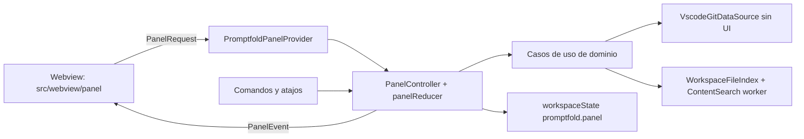

# Panel de Promptfold

Vista webview de unos 300 px, con la densidad de Source Control, para decidir qué entra al prompt y copiarlo sin QuickPicks. 1.1 cubre Git (Uncommitted, Commits y Branch), Files, Optimize en el corte de 1.1, y Output, con paridad de `gcopy`. 1.2 agrega Find files por el `+` de Files, Strip comments y Log excerpt. El mockup está en `docs/plans/promptfold-panel-mockup.html`.

Rama: `feature/promptfold-panel`, sobre `main` @ `0190593` (`test: format the prompt output test and drop the smoke log`). El mínimo es VS Code 1.107.0: `engines.vscode` es `^1.107.0` y `@types/vscode` es exacto `1.107.0`. Este documento no autoriza edits en `src/`.

`docs/` está en `.gitignore`. Estos dos archivos entran con `git add -f`, sin abrir el resto de `docs/`.

## Intención

El panel es para quien copia contexto a un LLM decenas de veces al día desde la barra lateral de VS Code o Cursor, a unos 300 px de ancho. La tarea es decidir qué entra al prompt y copiarlo. Debe sentirse como una sección nativa del sidebar: densa y técnica, en el estilo de la vista de control de código fuente.

- Profundidad: solo bordes (`--vscode-widget-border`, `--vscode-sideBar-border`), sin sombras.
- Medidas: fuente del usuario (`--vscode-font-size`; 13 px en el mockup), base de espaciado de 4 px, radio de 2 px. Controles interactivos de al menos 24 px de alto.
- Tipografía: la del sistema con `--vscode-font-*`. Rutas en `--vscode-editor-font-family` y números con `tabular-nums`.
Dirección D, ya elegida: encabezado, medidor visible cuando hay presupuesto, secciones plegables y pie fijo. No hay una segunda composición.

- Elemento propio: un medidor de tokens apilado (cambios, archivos y árbol) contra el presupuesto, con un tramo rayado para lo ahorrado.
- Color: el acento es índigo de marca, no el botón de VS Code. En alto contraste el acento no se fuerza. Los neutros siguen `--vscode-*`. Los únicos colores de estado son los de `gitDecoration` y el warning.
- Defaults que se descartan: tarjetas con sombra, varios botones primarios y badges de colores. Copy prompt es el único botón primario del panel completo.

## Decisiones

### Alcances

`GitScope` queda `Uncommitted | Commits | Branch`. Uncommitted junta index, working tree, untracked y merge, deduplicados por repo y ruta. 1.0.2 ya lee `untrackedChanges` y `mergeChanges`, y mapea los estados 12–18 a `modified`. El panel reutiliza eso. No se vuelve a implementar. `hidden` se respeta: si la API no trae el archivo nuevo, el panel no lo inventa. Staged desaparece. "Last commit" pasa a ser Commits con Latest 1.

Se borran `GitScope.Staged` y `GitScope.Commit` (`src/domain/entities/git-scope.enum.ts`), `gitScopeMenu`, la rama staged de `changesForScope` y de `fillChangeDiff` (`src/domain/services/git-diff.service.ts`), y los valores `staged` y `commit` como `presetScope` de `promptfold.selectChanges`. El CHANGELOG de 1.1 lo anota en Removed. La frase "el valor de scope se conserva" deja de ser cierta.

No choca con el código: esos símbolos existen y el plan los retira. Los tests que fijan `staged` y `commit` (`test/selectChanges.test.ts`, `test/gitDiff.test.ts`, `test/integration/workflow.test.ts`) se reescriben en el mismo commit que borra el alcance. No se dejan rojos.

### Inclusión de Git

No hay casilla "Include in prompt". La reemplazan las casillas de repo y de commit. Nada marcado es sin Git. El botón de icono del pie copia solo esa selección, como `gcopy`, y no toca los archivos del árbol.

Visibilidad, con esa regla:

- Con repos o commits marcados, el medidor muestra el tramo de cambios. La barra de estado agrega `+ Git: N repos` en Uncommitted y Branch, o `+ Git: N commits` en Commits. `N` es la selección.
- Cualquier Copy, Preview o Save as (panel, paleta o atajo) incluye Git solo si hay selección.
- Show details agrega `Git changes: included (3 repos, uncommitted)`, `Git changes: included (3 commits, combined)` o `Git changes: not included`.
- Tests de `summarizeSelection` y `selectionStatus` con selección y sin ella. Integración: sin selección no hay `<changes` ni `<commits`; con selección sí, y el reporte trae la línea.

`selectionStatus` vive en `src/domain/services/selection-budget.service.ts`. El texto actual es `$(files) ${fileCount} files · ${tokenLabel} · ${formatLabel}`. El sufijo se agrega solo con selección.

### Git ya no toca el árbol

`promptfold.diffMode` decide al construir el prompt si entra el contenido de los archivos cambiados. Las casillas del árbol quedan solo para lo que eliges. Se borra:

- `setCheckedFiles` dentro de `reloadRepo` y de `selectChanges` (`src/presentation/commands/git.commands.ts`).
- `applyChangeSelection`, `pathsToCheck`, `ChangeSelectionMode` y `GitChangeSelection`, si quedan sin uso.
- La parte de files de `syncChangeCheck` (`src/domain/services/side-views.service.ts`).
- `promptChanges` de `SelectionSnapshot`, su comparación en `sameSnapshot` (`src/domain/services/selection-history.service.ts`) y `publishChanges` en `src/presentation/commands/history.commands.ts`.

Los snapshots guardados se leen ignorando `promptChanges`. No se migran y no vuelven a marcar archivos.

### Vistas que sobran

La exclusión archivo por archivo vive en el panel. La vista "Git changes" (`src/presentation/views/git-changes.tree-provider.ts`, `promptfold.gitChanges`, sus menús inline y su listener en `selection.commands.ts`) y `src/presentation/views/git-file-decoration.provider.ts` se borran en 1.1. La decoración de Git del workbench se queda. Extensions se decide en 1.2.

### Git en el panel

Sección plegable: chevron, icono, título en mayúsculas pequeñas y resumen a la derecha. Control segmentado `Uncommitted | Commits | Branch`.

Uncommitted:

- Cada repo: casilla, nombre en mono, rama y tokens, desplegable.
- Dentro, sus archivos con casilla. Letra `M` / `A` / `U` / `D` y `+` / `−` contados del diff. `D` va tachado.
- El color de `gitDecoration` va en una marca de 8 px. La letra va en `--vscode-foreground`, salvo donde el color de Git pase 4.5:1 sobre el sidebar. `deletedResourceForeground` en oscuro (`#c74e39` sobre `#181818`) da 3.87:1 y no puede ser el texto. El nombre accesible incluye la palabra de estado.
- Un repo sin cambios queda deshabilitado, con el texto `no changes`.
- Debajo, `New files: Names | Content`. Es `promptfold.untrackedContent`.

Commits. Entra en 1.1, no en 1.2.

- Select de repo y filtro `Message, hash, author`.
- `Latest: 1 · 3 · 5 · 10` marca los últimos N de un clic, más `Clear`.
- Lista con casilla. Admite no consecutivos. Cada fila: hash corto, mensaje, fecha relativa, archivos y tokens. El estimado de la lista sale de `shortStat` y lleva `~`. Al marcar, el token se calcula del diff y pierde la tilde.
- `Show older commits` pagina.
- Resumen de la sección, sumando todos los repos: `3 commits · 8 files · +139 −27`.
- `Diff: Combined | Per commit` y casilla `Include commit messages`.
- La selección es por repo y se conserva al cambiar de repo.

Consecutividad. Ordenados de nuevo a viejo, cada commit marcado tiene como `parents[0]` al siguiente marcado. Un solo commit es consecutivo. Si no lo son, el modo efectivo es Per commit y una línea avisa: `Combined needs consecutive commits`. En Per commit, un merge se compara contra `parents[0]`.

Combined no pasa `EMPTY_TREE` a `diffBetween`. En el tag 1.107.0, `extensions/git/src/git.ts` línea 1692 arma `` `${ref1}...${ref2}` ``. El objeto vacío es un árbol, no un commit, y el rango de tres puntos falla. Issue #13.

- Con padre: `diffBetween(parents[0] del más viejo, el más nuevo)`.
- Sin padre: comparación directa de árboles, `diffBlobs(EMPTY_TREE, el más nuevo)`, y `show` para el contenido por archivo cuando haga falta. Es el fallback que `listCommitChanges` ya usa para un commit raíz. No se reemplaza por `diffBetween`.
- `EMPTY_TREE` puede quedar como metadato `from` en la salida. Eso no autoriza pasarlo a `diffBetween`.
- `diffBetweenPatch` no existe en `git.d.ts` de 1.107.0. No se usa.

Hoy `parentOf` pide `getCommit(\`${hash}~1\`)` en `src/infrastructure/datasources/vscode-git.datasource.ts`. Pasa a leer `Commit.parents[0]`. Si `parents` está vacío, es raíz.

Branch: base a comparar, con filtro. Upstream, dev y main primero, después el resto, como `git/list-base-branches`.

### Files

Lista lo marcado en el árbol: carpetas con su número de archivos, archivos sueltos, tokens y `Remove` por fila. Lo dejado fuera se ve como `pnpm-lock.yaml · left out · generated`, con `Add it anyway`.

El `+` del encabezado abre un menú. En 1.1 solo se muestra `Choose in tree`. `Find files` y `Log excerpt` son 1.2 y no se muestran en 1.1. Find files deja de ser una sección. Se conservan Glob, `picomatch`, el índice y el worker. Los snippets son filas de Files (`archivo:líneas`, tokens, `File changed`). Log excerpt abre la lista de entradas que ya define la sección Snippets y logs.

### Optimize

Vive en settings. No hay un segundo almacén. `workspaceState` no guarda el preset ni los interruptores. El preset se calcula: si los settings coinciden con Off, Balanced o Maximum, el segmento se marca; si no, no se marca ninguno.

Writes por el helper de ámbito. 1.0.1 ya lo tiene en `settingWriteTarget`. El panel lo reutiliza. No vuelve a escribir siempre en Workspace.

- Compact whitespace es `promptfold.compactWhitespace`, que ya existe. Sale de Output.
- Generated files as names es el inverso de `promptfold.includeGenerated`, que ya existe. No se crea otro setting. El switch encendido escribe `includeGenerated: false`: un generado que entra lo hace como nombre. El switch apagado escribe `includeGenerated: true` y el contenido vuelve a la selección masiva. La etiqueta no es "Lockfiles as names": `generatedPatterns` también cubre `*.min.js`, `*.min.css` y `*.map`, y el nls ya dice "lockfiles and minified or map files". Un switch solo de lockfiles mentiría o partiría ese setting.
- Trim long logs es `promptfold.compactLogs`, que la sección Snippets y logs ya define para 1.1. El switch entra en 1.1 con ese setting. No se duplica.
- Diff context es el setting nuevo `promptfold.diffContext`. Strip comments y Outline large files son settings nuevos y entran en su fase.

Fases, después de ese reparto:

- 1.1: Compact whitespace, Generated files as names, Diff context, Trim long logs.
- 1.2: Strip comments.
- 1.3 o después: Outline large files.

El mockup dibuja los interruptores de las tres fases, sin rótulos de versión dentro del marco. 1.1 solo cablea los suyos.

Preset calculado, para que el segmento tenga una definición:

- Off: interruptores de la fase apagados y `diffContext` 3. En 1.1 eso es compact whitespace apagado, `includeGenerated` true, `compactLogs` apagado y contexto 3.
- Balanced: compact whitespace encendido, generated as names encendido, `compactLogs` encendido y `diffContext` 1.
- Maximum: los interruptores que ya existen en la fase encendidos y `diffContext` 0.
- Cualquier otra combinación no marca segmento.

El segmento y el ahorro se comprueban contra el texto generado y los tokens medidos. Escribir el setting no basta. Copy, Preview y Save aplican la misma compactación.

`See what was removed` abre un Preview con lo que se quitó. No copia.

### Diff context

`extensions/git/src/api/git.d.ts` del tag `1.107.0` no tiene argumento de contexto. `diff` (línea 237) y `diffBetween` (líneas 249-250) no reciben `-U`. `diffBetweenPatch` no está en ese archivo. `show` (línea 229) sí devuelve el texto de un blob. Promptfold no lanza `git`.

Tres opciones:

1. `0 | 1 | 3`, recortando el parche que devuelve la API. El 3 lo conserva. 0 y 1 recortan líneas de contexto y reescriben `@@`. Si el parche ya trae menos de 3, no se rellena. No hay 10.
2. Además 10, ampliando cada hunk con líneas de la versión nueva: `readFile` en Uncommitted, `show(ref, path)` en Commits y Branch, y fusionando los hunks que se toquen.
3. `api.git.path` con `child_process` y `-U`, solo si 1 y 2 no alcanzan.

Recomendación: la 1, en 1.1. Costo: una función pura y tests del encabezado `@@`. Sin lectura de archivos y sin proceso. La 2 también es pura y sin dependencias, y alcanza para 10, pero suma parseo de hunks, fusión y fallos en borrados, renames y binarios. No hace falta para el corte de 1.1. La 3 no se usa: 1 y 2 alcanzan, y el plan no lanza `git`.

### API de Git

Fuente: tag `1.107.0`, la versión de `engines`. No se cita `main` de VS Code.

- `Repository.log` está en `git.d.ts` línea 283. `LogOptions` (líneas 139-152) tiene `maxEntries` (default 32, línea 141), `shortStats` (línea 147), `author` (línea 148), `grep` (línea 149) y `skip` (línea 152). Se pagina con `skip`.
- El filtro de mensaje usa `grep`. El de autor usa `author`. El hash se filtra sobre lo ya cargado. No se lanza un proceso.
- `Commit.parents` es `readonly parents: string[]` (línea 58). `shortStat` es opcional (línea 63).
- El padre sale de `parents[0]`. Si no hay padre, la comparación directa usa `diffBlobs`, no `diffBetween`.
- `vscode.l10n.t` está en `src/vscode-dts/vscode.d.ts` línea 18122. `Webview` está en la línea 9917. Los textos del panel salen por `l10n.t`.

La fecha relativa y los números los formatea el host con `Intl` y `vscode.env.language`. La webview no arma fechas.

### Glob

Opción elegida: `picomatch` con versión exacta, única dependencia nueva, más `@types/picomatch` exacto en devDependencies. Entra en 1.2, con Find files.

Los globs de `fcopy` vienen de zsh, con `**`, llaves, clases y extglob. Un matcher propio tendría que reimplementar y mantener esos bordes (puntos iniciales, `**` en medio, llaves anidadas, escapes). `picomatch` no tiene dependencias, es el motor de micromatch y fast-glob, y se le pasan rutas POSIX ya normalizadas, así que Windows no cambia la semántica.

El dominio no importa la librería: queda detrás de un puerto `GlobMatcher`. El test de manifest (`test/manifest.test.ts`, hoy `assert.deepEqual(Object.keys(dependencies), ['ignore'])`) pasa a exigir exactamente `ignore` y `picomatch`. También se agrega `!node_modules/picomatch/**` en `.vscodeignore`, al lado de `!node_modules/ignore/**`.

Los tests por caso cubren `*`, `**`, `?`, `{a,b}`, sufijos, `.blade.php`, dotfiles, archivos sin extensión, entradas con `\` y separadores de Windows. Los sufijos siguen las reglas de `matchesExtension` (`src/presentation/views/extensions.provider.ts`).

### Atajos dentro de la webview

VS Code reenvía al workbench los keydown de la webview que la página no consume, y ahí se resuelven los keybindings con `focusedView == 'promptfold.panel'`.

- El script del panel nunca hace `preventDefault` ni `stopPropagation` en Mod+Enter, Mod+Shift+Enter ni Mod+C.
- No se registra ningún keybinding de Mod+C para el panel. Hoy `promptfold.copyFiles` está en `cmd+c` / `ctrl+c` con `focusedView == 'promptfoldView'` (`package.json`). Ese binding no se copia al panel: Mod+C dentro de un input copia el texto seleccionado.
- Playwright prueba que Mod+Enter y Mod+Shift+Enter con el foco en un input no se consumen y no disparan `postMessage` duplicado, y que Mod+C conserva la acción por defecto.
- Checklist manual en VS Code stable y en Cursor: con el foco en el filtro de commits o en el de ramas, Mod+Enter copia el prompt, Mod+Shift+Enter copia los cambios o los commits seleccionados, y Mod+C sobre texto seleccionado copia solo ese texto. El botón Copy prompt declara `aria-keyshortcuts`: `Meta+Enter` en macOS y `Control+Enter` en Windows y Linux.

Atajo global candidato para Copy changes: se verifica contra los keybindings por defecto de VS Code stable y de Cursor. En Cursor, `cmd+k`, `cmd+l` y `cmd+i` están ocupados. En Windows se evita `ctrl+alt` por AltGr. Si no queda una combinación libre, se publica sin atajo global y se documenta cómo asignarlo.

### Medidor

`role="meter"`, `aria-valuemin="0"`, `aria-valuemax` igual al presupuesto y `aria-valuenow` limitado al máximo.

El medidor está siempre visible. El texto es mono, con `tabular-nums`: `41k / 64k tokens`. A la derecha, `−9k optimized`. La barra apila changes, files y tree, y un tramo rayado para lo ahorrado. La leyenda es `changes 12k · files 27k · tree 2k`. El rayado no es el único indicador.

`aria-valuetext` describe el desglose. El mismo texto va en `title`. Si el ahorro es mayor que 0, se agrega `Optimizations saved 9k`.

- Dentro del presupuesto: `41k of 64k tokens: changes 12k, files 27k, tree 2k. Optimizations saved 9k`
- Con exceso: `84k of 64k tokens, 20k over budget: changes 31k, files 50k, tree 3k. Optimizations saved 9k`

Con `tokenBudget = 0` no hay meter: queda un texto de estado con el desglose y la acción "Set a token budget".

### Dónde se escriben las casillas de Output

Escriben en el ámbito donde vive el valor efectivo: Workspace si ya hay un valor de workspace, y si no, User. Así no se ensucia `.vscode/settings.json`. 1.0.1 ya lo hace en `settingWriteTarget`. El panel reutiliza ese helper para el formato, el árbol, `includeGenerated`, `compactWhitespace`, `compactLogs` y `promptfold.diffContext`.

Un valor solo de carpeta (`workspaceFolderValue`) no cuenta como valor de workspace para esta regla: el write va a User. No se agrega un tercer target.

## Arquitectura



El host es la fuente de verdad. La webview no tiene lógica de dominio.

Casos de uso nuevos en `src/domain/use-cases/`:

| Caso | Responsabilidad |
| --- | --- |
| `git/describe-repositories` | Nombre, rama, upstream, ahead/behind y número de cambios, leídos del estado de la API. Promptfold no lanza `git`. |
| `git/list-base-branches` | Upstream, dev y main primero, después el resto. Extiende `baseChoices`. |
| `git/list-commits` | Página de un repo. `repository.log({ maxEntries, skip, shortStats: true, grep, author })`. `Show older commits` sube `skip`. El hash se filtra en la página cargada. |
| `git/collect-changes` | Uncommitted y Branch. Recibe repos, exclusiones por archivo, base y `promptfold.untrackedContent`. No abre QuickPick. |
| `git/collect-commits` | Combined o Per commit, consecutividad, mensajes. Con padre: `diffBetween(padre del más viejo, el más nuevo)`. Sin padre: `diffBlobs(EMPTY_TREE, el más nuevo)`. Nunca `diffBetween(EMPTY_TREE, …)`. |
| `prompt/optimize` | Transformaciones puras. Cada una devuelve el texto y el ahorro (`tokensBefore - tokensAfter`). |
| `prompt/summarize-selection` | Alimenta el medidor y la barra de estado. |
| `files/find-files` | Pattern y Contains. 1.2, disparado por el `+` de Files. |
| `selection/apply-file-selection` | Add o Replace, y registra el historial. 1.2. |

Lo que recalcula (commits, filtro, optimize, medidor) lleva `requestId`. El host aplica debounce y descarta la respuesta si el id ya no es el último.

Servicios puros:

- `change-context.service.ts` calcula los repos marcados al inicio. Las marcas no se persisten: se recalculan cada vez que se resuelve el panel.
- En 1.2, `file-pattern.service.ts` reparte los tokens entre globs (`picomatch`, detrás de `GlobMatcher`) y sufijos (`matchesExtension`).

El provider del panel se registra antes del chequeo de workspace en `activate` (`src/extension.ts`). Hoy, si no hay carpeta, `activate` muestra "Please open a workspace folder to use this extension." y retorna. El panel tiene que existir antes de ese return para poder dibujar el estado sin carpeta. Las webviews no tienen `viewsWelcome`, por eso los estados vacíos los dibuja el panel.

Estados vacíos de la sección Git, cada uno con su acción:

| Estado | Texto | Acción |
| --- | --- | --- |
| Git no disponible | `Git is not available in this window.` | "Show Git extension": abre la búsqueda `@builtin git` en Extensions. |
| Sin repos | `No Git repositories in this workspace.` | "Initialize repository" (`git.init`). |
| Sin carpeta | `Open a folder to build prompts from its files.` | "Open folder". |

`VscodeGitDataSource` pierde los QuickPick y el InputBox de `src/infrastructure/datasources/vscode-git.datasource.ts` (el pick de commit alrededor de las líneas 262-269 y el pick de base más el InputBox alrededor de las líneas 312-340). La infraestructura deja de preguntar al usuario. El contrato `GitDataSource.getChangesForScope` ya recibe `options.base` / `options.commit` / `options.forcedBase`; el panel los llena.

Contains corre en un `worker_threads`, parte de Node, sin dependencias nuevas. Respeta el resolver (ignore, sensibles, generados, binarios y `maxFileBytes`), se cancela, y se termina por timeout si una regex se atasca.

La webview se escribe en TypeScript dentro de `src/webview/panel/`. Se compila con un `tsconfig.webview.json` nuevo (`lib` DOM, ESM) hacia `out/webview`. El `tsconfig.json` del host incluye hoy todo `src` y excluye `test`. Tiene que excluir `src/webview/**`, porque ese árbol se compila aparte. `panel-html.ts` se queda en `src/presentation/panel/`: corre en el extension host, arma el HTML con el nonce, el `cspSource` y las URIs, y lo compila el tsconfig de Node.

Sin bundler, sin frameworks y sin Webview UI Toolkit. Los iconos son SVG inline.

## Estilos

`@tailwindcss/cli` con versión exacta en devDependencies. El CLI trae su propio `tailwindcss`; si la instalación muestra que hace falta como peer, también va exacto. `dependencies` no cambia en 1.1.

Script:

```json
"build:webview-css": "tailwindcss -i src/webview/panel/panel.css -o media/panel.css --minify"
```

`compile` pasa a `npm run build:webview-css && tsc -p ./ && tsc -p tsconfig.webview.json`. Así entra también en `vscode:prepublish`, que ya llama a `compile`. Hoy `compile` es solo `tsc -p ./`.

`media/panel.css` es un artefacto de build: se agrega a `.gitignore` y no se commitea. El VSIX sí lo lleva. `.vscodeignore` ya excluye `src/**`, así que el CSS fuente no entra.

El CI falla si el CSS no está generado. Los dos workflows que compilan son `.github/workflows/test.yml` y `.github/workflows/publish.yml`.

- Después de `compile`, un paso falla si `media/panel.css` no existe o está vacío.
- Otro paso corre `npx vsce ls` y exige que `media/panel.css` esté y que `src/webview/panel/panel.css` no.
- La integración también comprueba que el `<link>` del panel apunte a un archivo que existe.

Fuente `src/webview/panel/panel.css`, sin Preflight:

```css
@import 'tailwindcss/theme' layer(theme);
@import 'tailwindcss/utilities' layer(utilities);
@source '../';
@source '../../presentation/panel/panel-html.ts';

@theme {
  --color-*: initial;
  --font-*: initial;
  --radius-*: initial;
  --text-*: initial;
  --spacing: 4px;
  --text-ui: var(--vscode-font-size);
  --text-ui--line-height: 1.5;
  --text-meta: calc(var(--vscode-font-size) * 0.92);
  --text-meta--line-height: 1.4;
  --color-sidebar: var(--vscode-sideBar-background);
  --color-fg: var(--vscode-foreground);
  --color-fg-muted: var(--vscode-descriptionForeground);
  --color-widget-border: var(--vscode-widget-border);
  --color-button: var(--vscode-button-background);
  --color-button-fg: var(--vscode-button-foreground);
  --color-button-hover: var(--vscode-button-hoverBackground);
  --color-button-secondary: var(--vscode-button-secondaryBackground);
  --color-input: var(--vscode-input-background);
  --color-input-border: var(--vscode-input-border);
  --color-focus: var(--vscode-focusBorder);
  --color-git-modified: var(--vscode-gitDecoration-modifiedResourceForeground);
  --color-git-added: var(--vscode-gitDecoration-addedResourceForeground);
  --color-git-deleted: var(--vscode-gitDecoration-deletedResourceForeground);
  --color-git-untracked: var(--vscode-gitDecoration-untrackedResourceForeground);
  --color-git-submodule: var(--vscode-gitDecoration-submoduleResourceForeground);
  --color-warning: var(--vscode-editorWarning-foreground);
  --color-error: var(--vscode-errorForeground);
  --color-list-hover: var(--vscode-list-hoverBackground);
  --color-list-active: var(--vscode-list-activeSelectionBackground);
  --color-accent: var(--pf-accent);
  --color-accent-hover: var(--pf-accent-hover);
  --color-accent-fg: var(--pf-accent-fg);
  --color-accent-text: var(--pf-accent-text);
  --color-accent-meter: var(--pf-accent-meter);
  --color-accent-soft: var(--pf-accent-soft);
  --color-accent-deep: var(--pf-accent-deep);
  --font-ui: var(--vscode-font-family);
  --font-mono: var(--vscode-editor-font-family);
  --radius-control: 2px;
}
```

- `--color-*: initial` borra la paleta por defecto. Tailwind v4 lo documenta así. Después del reset solo existen los tokens declarados, así que `bg-blue-500` no genera nada. Los neutros siguen en `--vscode-*`. Los únicos tokens nuevos son los `accent`, y apuntan a `--pf-accent*`.
- El botón primario usa `bg-accent` y `text-accent-fg`. No usa `--color-button`.

Los valores de `--pf-accent*` viven en el `body`, porque el claro y el alto contraste no caben en un solo `@theme`. La referencia es `src/vs/workbench/contrib/webview/browser/pre/index.html` del tag `1.107.0`, función `applyStyles` (línea 510). Al cambiar de tema quita `vscode-light`, `vscode-dark`, `vscode-high-contrast` y `vscode-high-contrast-light` (línea 516). Si el tema activo es `vscode-high-contrast-light`, agrega esa clase y también `vscode-high-contrast` (líneas 520-522). Escribe `body.dataset.vscodeThemeKind`, que expone `data-vscode-theme-kind` (línea 534). El mockup tiene que reproducir las dos clases y el atributo. Issue #14.

Oscuro, `body.vscode-dark`. Sidebar `#181818`.

| Token | Valor | Uso | Contraste |
| --- | --- | --- | --- |
| `--pf-accent` | `#5B5BD6` | Relleno del botón | Blanco encima, 5.37:1 |
| `--pf-accent-hover` | `#4C4C9E` | Hover del botón | Blanco encima, mayor que 5.37:1 |
| `--pf-accent-fg` | `#FFFFFF` | Texto del botón | 5.37:1 sobre `#5B5BD6` |
| `--pf-accent-text` | `#A3A3F7` | Texto, enlace y `−9k` | 7.73:1 sobre `#181818` |
| `--pf-accent-meter` | `#8B8BF0` | Tramo del medidor | 5.96:1 sobre `#181818` |
| `--pf-accent-soft` | `#C9C9FA` | Tramo claro | 11.18:1 sobre `#181818` |
| `--pf-accent-deep` | `#4C4C9E` | Relleno, nunca texto | 2.40:1 sobre `#181818`. No pasa AA |

Claro, `body.vscode-light`. Sidebar `#F8F8F8`. `#A3A3F7` sobre ese fondo da 2.16:1 y no se usa como texto.

| Token | Valor | Contraste sobre `#F8F8F8` |
| --- | --- | --- |
| `--pf-accent` | `#5B5BD6` | El botón sigue con texto blanco, 5.37:1 sobre el relleno |
| `--pf-accent-text` | `#4C4C9E` | 6.98:1 |
| `--pf-accent-meter` | `#5B5BD6` | 5.05:1 |
| `--pf-accent-soft` | `#3C3C9A` | 8.58:1 |
| `--pf-accent-deep` | `#2F2F86` | 10.56:1 |

Alto contraste oscuro: solo `body.vscode-high-contrast`. Alto contraste claro: `body.vscode-high-contrast` y `body.vscode-high-contrast-light` a la vez. El índigo no se fuerza. `--pf-accent` y `--pf-accent-hover` apuntan a `--vscode-button-background` y `--vscode-button-hoverBackground`. `--pf-accent-fg` apunta a `--vscode-button-foreground`. El texto y el medidor apuntan a `--vscode-contrastActiveBorder`. El foco también usa ese borde. Las reglas del claro van después de las compartidas, o usan el selector `body.vscode-high-contrast.vscode-high-contrast-light`, para que ganen cuando las dos clases están presentes.
- `--text-*: initial` deja solo `text-ui`, que sigue el tamaño de fuente del usuario, y `text-meta`, un 92 % para ramas, contadores y rutas secundarias. Cada uno tiene su line-height. Ninguna clase del panel usa `rem`.
- El test de clases literales rechaza valores arbitrarios con `rem`, como `text-[0.8rem]` o `p-[1rem]`.
- El paso de CI que valida `media/panel.css` falla si el CSS generado contiene `rem`.
- Alto contraste usa `--vscode-contrastBorder` y `--vscode-contrastActiveBorder` dentro del mismo `@theme`. En Dark Modern y Light Modern esos tokens son null en el color registry de VS Code 1.107.0.

`panel-html.ts` tiene su propio `@source` porque el host lo compila aparte del árbol DOM. El test de clases literales cubre `src/webview/**/*.ts` y también `src/presentation/panel/panel-html.ts`.

CSP intacta: `style-src ${cspSource}` con un solo `<link>`. Sin CDN, sin `<style>` y sin atributos `style`. Los anchos del medidor se fijan por CSSOM (`element.style.width`), que la CSP permite.

CSP con nonce: `default-src 'none'; style-src ${cspSource}; script-src 'nonce-…'; img-src ${cspSource} data:`. Sin recursos remotos.

Clases solo literales en `src/webview/**/*.ts` y en `panel-html.ts`:

- Sin concatenar, sin template literals y sin construir nombres de clase.
- Los estados se expresan con variantes de atributo (`aria-checked:`, `aria-pressed:`, `aria-disabled:`, `data-[over=true]:`) o con `classList.toggle('clase-literal', condición)`.
- Un test unitario recorre esos archivos. Falla si encuentra `${`, `+` o `.join(` dentro de un `class` / `className`, o un valor arbitrario con `rem`.
- La regla queda documentada en `CONTRIBUTING.md`, en la sección Architecture.

`prettier --check src` también formatea `panel.css`. Si Prettier no acepta alguna directiva de Tailwind, el archivo va a `.prettierignore` y se documenta.

Playwright carga el mismo `media/panel.css` generado. El cierre del commit de Tailwind reporta el tamaño de `media/panel.css` y la nueva lista de `vsce ls`.

## Protocolo

`src/shared/panel-protocol.ts`, compartido por los dos tsconfig. Uniones discriminadas por enum.

```ts
export enum PanelRequestType {
  Ready = 'ready',
  SetGitMode = 'git.setMode',
  ToggleRepository = 'git.toggleRepository',
  ToggleChangedFile = 'git.toggleChangedFile',
  SetUntracked = 'git.setUntracked',
  SetBase = 'git.setBase',
  SetCommitRepo = 'git.setCommitRepo',
  SetCommitFilter = 'git.setCommitFilter',
  ToggleCommit = 'git.toggleCommit',
  SelectLatestCommits = 'git.selectLatest',
  ClearCommits = 'git.clearCommits',
  PageCommits = 'git.pageCommits',
  SetCommitDiffMode = 'git.setCommitDiffMode',
  SetIncludeCommitMessages = 'git.setIncludeCommitMessages',
  CopyGit = 'git.copy',
  RefreshGit = 'git.refresh',
  RemoveFile = 'files.remove',
  AddAnyway = 'files.addAnyway',
  ChooseInTree = 'files.chooseInTree',
  SetOptimizePreset = 'optimize.setPreset',
  ToggleOptimize = 'optimize.toggle',
  SetDiffContext = 'optimize.setDiffContext',
  PreviewRemoved = 'optimize.previewRemoved',
  RunEmptyAction = 'empty.run',
  SetFormat = 'output.setFormat',
  SetIncludeTree = 'output.setIncludeTree',
  Copy = 'output.copy',
  Preview = 'output.preview',
  SaveAs = 'output.saveAs',
  OpenSetting = 'openSetting',
  SetSectionOpen = 'section.setOpen'
}
```

`git.setMode` vale `uncommitted`, `commits` o `branch`. `git.setCommitDiffMode` vale `combined` o `per-commit`. `optimize.setDiffContext` vale `0`, `1` o `3`. `git.copy` copia los cambios o los commits seleccionados, según el modo. No hay `output.setCompactWhitespace`: Compact whitespace se escribe desde Optimize. `optimize.setPreset` no guarda un preset: escribe los settings de la combinación y el host recalcula el segmento.

Requests que recalculan llevan `requestId`: filtro de commits, página, optimize y el medidor. El host aplica debounce y descarta la respuesta vieja.

Eventos del host a la webview en 1.1: `state` (snapshot completo más `strings` localizados), `git.repositories`, `git.commits`, `git.branches`, `files.selection`, `optimize.measure` y `output.measure`.

En 1.2 se agregan `find.query` y `find.apply` como requests, y `find.progress` y `find.result` como eventos. Llevan `requestId` y los resultados viejos se descartan.

Los textos de la webview no se hardcodean en el script. El host los manda en `state.strings`, producidos con `vscode.l10n.t`, para que entren al bundle es y los vea `test/l10n-bundle.test.ts`.

## Persistencia

- `workspaceState`, clave `promptfold.panel`: modo Git, commits marcados por repo, filtro de commits y secciones abiertas. Nada más. Cerradas, el encabezado muestra `Git · 2 repos · Uncommitted`, `Files · 4 files · 27k`, `Optimize · Balanced`, `Output · XML`.
- El preset y los interruptores no se guardan ahí. Son settings. Al resolver, el host lee los settings y calcula el segmento.
- Las marcas de repos se recalculan desde el contexto. No se guardan.
- `getState` / `setState` de la webview: texto a medio escribir, scroll y foco. Así no hace falta `retainContextWhenHidden`.
- `promptfold.untrackedContent`, `includeGenerated`, `compactWhitespace`, `compactLogs` y `promptfold.diffContext` son settings.

Los snapshots viejos de historial traen `promptChanges` (`SelectionSnapshot` en `src/extension.ts`). Al restaurar el historial se ignoran. No se migran y no vuelven a marcar archivos.

## QuickPicks

Se eliminan de la ruta interactiva:

- La cadena de `selectChanges`: repos, alcance, Add/Replace y el modal "Include the submodule diff?". El comando queda y, si no recibe argumentos, usa el estado del panel. `presetBase` se conserva. `presetScope` ya no acepta `staged` ni `commit`.
- `promptfold.gitChanges.setScope` y `promptfold.gitChanges.setBase`, con sus menús inline (`view == promptfold.gitChanges && viewItem == gitRepo`) y sus claves nls.
- Los pickers de commit y de base dentro de `VscodeGitDataSource`.

Quedan como fallback:

- `selectByExtension` en el menú contextual de carpetas, porque está acotado a esa carpeta.
- `changeOutputFormat` al hacer clic en la barra de estado: es un solo paso. El write pasa al helper de ámbito.
- El diálogo nativo de Save as.
- El modal de presupuesto, solo cuando la copia viene de la paleta o de un atajo. Desde el panel el exceso ya se ve en línea.

En el panel, el modo Git, New files, Diff, el preset, Diff context y Format son controles segmentados de una fila (`role="radiogroup"`, flechas). Etiquetas: `Uncommitted`, `Commits`, `Branch`; `Names`, `Content`; `Combined`, `Per commit`; `Off`, `Balanced`, `Maximum`; `0`, `1`, `3`; `XML`, `Markdown`, `Text`. El estado lo da el segmento, no una fila resaltada. `gitScopeMenu` desaparece. Untracked sigue siendo `names` y `content`.

## package.json

Vista, la primera del contenedor `promptfold`, antes de `promptfoldView`:

```json
{ "type": "webview", "id": "promptfold.panel", "name": "%promptfold.panel.name%" }
```

`activationEvents` gana `onView:promptfold.panel`. Se quita la vista `promptfold.gitChanges`. Extensions conserva `visibility: collapsed` hasta 1.2.

Comando nuevo `promptfold.copyGit`, category Promptfold. El título sigue al modo: "Copy changes" / "Copiar cambios", o "Copy the selected commits" / "Copiar los commits seleccionados". Se quitan `promptfold.gitChanges.setScope` y `promptfold.gitChanges.setBase`, y la vista.

Atajos con la vista enfocada (`focusedView == 'promptfold.panel'`):

- `ctrl+enter` / `cmd+enter` copia el prompt. El botón declara `aria-keyshortcuts="Control+Enter"` o `aria-keyshortcuts="Meta+Enter"`.
- `ctrl+shift+enter` / `cmd+shift+enter` copia los cambios o los commits seleccionados, según el modo.

No hay binding de Mod+C para el panel.

Settings. Los de 1.2 y 1.3 se declaran cuando se cablean.

| Setting | Tipo | Default | Fase |
| --- | --- | --- | --- |
| `promptfold.untrackedContent` | `names` \| `content` | `names` | 1.1 |
| `promptfold.repositoryMarkLimit` | number, mínimo 1 | 8 | 1.1 |
| `promptfold.diffContext` | `0` \| `1` \| `3` | `3` | 1.1 |
| `promptfold.compactLogs` | boolean | `true` | 1.1, ya definido en Snippets y logs |
| `promptfold.stripComments` | boolean | `false` | 1.2 |
| `promptfold.outlineLargeFiles` | boolean | `false` | 1.3 |

`promptfold.compactWhitespace` y `promptfold.includeGenerated` ya existen. No se renombran. `includeGenerated` se escribe invertido desde el switch "Generated files as names".

Scripts y devDependencies de 1.1: `build:webview-css`, el `compile` nuevo, `@tailwindcss/cli` exacto y `@playwright/test` exacto. En 1.2: `picomatch` exacto en dependencies y `@types/picomatch` exacto en devDependencies.

nls en `package.nls.json` y `package.nls.es.json` para la vista, el comando y los settings. Inglés de la vista: "Prompt". Español: "Prompt". El comando: "Copy changes" / "Copiar cambios", y "Copy the selected commits" / "Copiar los commits seleccionados".

Descripción de `promptfold.diffContext`, en inglés:

`How many context lines to keep in a Git diff. 3 keeps the patch from the Git API. 1 and 0 trim context lines. 10 is not available.`

Español neutro:

`Cuántas líneas de contexto conservar en un diff de Git. 3 conserva el parche de la API de Git. 1 y 0 recortan contexto. 10 no está disponible.`

El nls de `promptfold.includeGenerated` se actualiza para decir que, apagado, un generado que entra lo hace como nombre.

## Formato de salida

`scope` queda `uncommitted`, `commits` o `branch`. `staged` y `commit` salen.

El encabezado nuevo reemplaza los atributos actuales `base` y `head` de `serializeChanges` (`src/domain/services/prompt-xml.service.ts`) en los alcances que no son branch. En `branch`, `base` se queda: es la base de la comparación y no es lo mismo que la rama actual.

XML, alcance uncommitted:

```xml
<changes repo="api" scope="uncommitted" branch="feature/panel" upstream="origin/feature/panel" ahead="2" behind="0">
```

XML, alcance branch:

```xml
<changes repo="api" scope="branch" base="dev" branch="feature/panel" upstream="origin/feature/panel" ahead="2" behind="0">
```

En el alcance commit, el mensaje va en `<message>` con CDATA. En detached HEAD se escribe `detached="abc1234"` en lugar de `branch`. Sin upstream no se escriben `upstream`, `ahead` ni `behind`. En modo names, cada untracked va como `<change path="…" status="untracked"/>`. Un archivo sensible no entra nunca, ni en names ni en content.

Markdown. El heading actual es `## Git changes — api (uncommitted, main → HEAD)` (`prompt-formats.service.ts`). Pasa a:

```markdown
## Git changes — api (uncommitted)
Branch: feature/panel · Upstream: origin/feature/panel · 2 ahead, 0 behind
```

Plain. Encima de los `=== DIFF ===` actuales:

```text
=== REPO api · feature/panel → origin/feature/panel · 2 ahead, 0 behind ===
```

Detached usa el commit corto en lugar del nombre de rama. Sin upstream, la flecha y el ahead/behind no se escriben.

Varios commits. El envoltorio es el mismo en XML, Markdown y Text.

XML, Per commit. Cada `<commit>` lleva `<message>` en CDATA si `Include commit messages` está activo, y sus `<change>`.

```xml
<commits repo="api" mode="per-commit">
  <commit hash="a1b2c3d">
    <message><![CDATA[Add invoice payment schema]]></message>
    <change path="packages/billing/src/domain/invoice-payment.schema.ts" status="modified"/>
  </commit>
</commits>
```

XML, Combined. Un `<changes scope="commits" from to>`. `to` es el más nuevo. `from` es `parents[0]` del más viejo cuando existe. Si el más viejo es raíz, `from` puede ser el hash de `EMPTY_TREE` como metadato. El diff de ese caso no sale de `diffBetween`: sale de `diffBlobs(EMPTY_TREE, to)`. Con mensajes, antes del diff va `<messages>`.

```xml
<commits repo="api" mode="combined">
  <messages>
    <message hash="a1b2c3d"><![CDATA[Add invoice payment schema]]></message>
  </messages>
  <changes scope="commits" from="0ff1ce0" to="c3d4e5f">
  </changes>
</commits>
```

Markdown:

```markdown
## Commits — api (per-commit)
### a1b2c3d
Add invoice payment schema
```

```markdown
## Commits — api (combined, 0ff1ce0 → c3d4e5f)
```

Plain:

```text
=== COMMITS api · per-commit ===
=== a1b2c3d ===
Add invoice payment schema
```

```text
=== COMMITS api · combined · 0ff1ce0 → c3d4e5f ===
```

Sin mensajes, no se escribe `<message>` ni `<messages>`. El hash se queda.

## Riesgos

- Submódulos que pasan de `git.detectSubmodulesLimit` aparecen sin estado, como filas desactivadas.
- Repo sin upstream: no hay ahead/behind y la opción Upstream no aplica.
- Detached HEAD: se muestra el commit corto. Repo sin commits: el modo Commits muestra `No commits in this repository.`
- Combined sobre commits no consecutivos cae a Per commit y muestra `Combined needs consecutive commits`.
- `diffBetween` en 1.107.0 arma tres puntos (`git.ts` línea 1692). Pasarle `EMPTY_TREE` falla: el objeto es un árbol, no un commit. El test tiene que usar Git real, no un mock que solo registre `from` y `to`.
- Diff context 10 no se ofrece. Un hunk mal recortado cambia el parche: el test fija el `@@`.
- Si un repo no tiene la base elegida, su fila lo dice y se omite de `collect-changes`.
- Windows: rutas POSIX, raíces sin distinguir mayúsculas, CRLF y la ruta del worker vía `__dirname`.
- Cursor y Antigravity: hay que verificar que su base cumpla `engines.vscode` `^1.107.0`. También el choque de atajos. Antigravity en Windows sigue pendiente de prueba manual (issue #9).
- Rendimiento en un workspace grande: el índice se recorre una vez y se invalida con FileSystemWatcher con debounce. El pattern se resuelve en memoria. Contains va en el worker con progreso y tope en `maxFiles`. La lista de ramas se pide solo cuando se abre Branch. El marcado inicial se detiene en `promptfold.repositoryMarkLimit` (8).
- Los snapshots viejos con `promptChanges` se ignoran al restaurar el historial.
- Multi-root sigue con `workspaceFolders[0]`.
- Light Modern define `editorWarning.foreground` en `#BF8803`. Sobre `#F8F8F8` el contraste es 2.93:1. El texto de exceso no puede ir en ese color sobre el sidebar: va en un chip con texto `#1F1F1F` sobre el warning, que da 5.29:1. Dark Modern (`#CCA700` sobre `#181818`) sí pasa como texto (7.69:1). El mockup usa el chip en los dos temas para no depender del tema.
- `gitDecoration.deletedResourceForeground` en oscuro (`#c74e39` sobre `#181818`) da 3.87:1. Sirve para una marca gráfica, no como único texto de 13 px. La letra de estado va en `--vscode-foreground` y la marca usa el color de Git.
- En Light Modern, `descriptionForeground` es `#3B3B3B`, igual que `foreground`. La jerarquía de meta no puede ser de color: es tamaño (`text-meta`) y peso.

## Tests

Unit con `node:test` (`npm run test:unit`):

- 1.1
  - Contexto inicial: editor en un repo, en un submódulo, sin editor, más de N repos, y nunca repos fuera del workspace.
  - Orden de las bases: upstream, dev, main, después el resto.
  - Overview con detached HEAD, sin upstream y sin commits.
  - Encabezados XML, Markdown y Plain contra las salidas de la sección Formato.
  - Untracked names y content, incluido un archivo sensible que nunca entra.
  - Mensaje del commit en `<message>` con CDATA.
  - `panelReducer`.
  - `summarizeSelection` y `selectionStatus` con selección y sin ella. Con repos: `+ Git: 3 repos`. Con commits: `+ Git: 3 commits`. Sin selección: no hay sufijo y changes es 0.
  - `aria-valuetext` del medidor, dentro y fuera de presupuesto, con `Optimizations saved 9k` solo si el ahorro es mayor que 0, y `tokenBudget = 0` sin `role="meter"`.
  - Consecutividad: una cadena permite Combined. Un hueco lo impide y deja `Combined needs consecutive commits`.
  - Combined con padre llama a `diffBetween(padre del más viejo, el más nuevo)` y no pasa `EMPTY_TREE`. Combined que incluye la raíz usa `diffBlobs(EMPTY_TREE, el más nuevo)`. Un mock que solo registre `from` y `to` no basta: el test aplica el resultado con Git real. Per commit escribe un `<commit hash>` por commit. Sin mensajes, no hay `<message>`.
  - Presets y ahorro se afirman contra el texto generado y los tokens medidos, no solo contra el write del setting. Copy, Preview y Save usan la misma compactación.
  - Issue #10: el archivo nuevo llega a la salida serializada, y un archivo staged que se edita después aparece una vez con el contenido combinado.
  - Issue #11: un archivo que solo está en `mergeChanges` entra, y un conflicto de borrado no se pierde ni se trata como archivo vacío leído con éxito.
  - Issue #12 bloquea aceptar la salida de `newFileDiff` y del fallback de commit raíz hasta corregir saltos finales y el parche de archivo vacío. Este plan no lo implementa.
  - Diff context 3 no altera el parche. 1 y 0 recortan contexto y reescriben `@@`. No existe 10.
  - El token de una fila sin marcar sale de `shortStat` y lleva `~`. Al marcar, sale del diff y no lleva `~`.
  - El preset se calcula. Una combinación que no es Off, Balanced ni Maximum no marca segmento.
  - El switch de generated escribe `includeGenerated` invertido. No crea otro setting.
- 1.2: globs y sufijos con picomatch (casos de la sección Glob) y el matcher del worker.

Integración con Mocha (`npm run test:vscode`):

- El fixture gana un remoto bare para ahead/behind y un submódulo.
- 1.1
  - `copyChanges`.
  - `selectChanges` con un stub que falla si se abre un QuickPick. Los argumentos programáticos no abren UI.
  - Copy sin selección de Git no lleva `<changes` ni `<commits`. Con repos lleva `<changes`. Con commits lleva `<commits`. El reporte trae la línea de Show details que corresponde.
  - La vista resuelve bien sin carpeta: el estado vacío "Open a folder to build prompts from its files." y la acción "Open folder".
- 1.2: Find Add y Replace.
- El panel se maneja por la API que devuelve `activate()`. Hoy `activate` no devuelve esa API: el commit que registra el provider la expone.

Playwright: `@playwright/test` como devDependency con versión exacta. Corre sobre el HTML que renderiza `panel-html.ts`, con `acquireVsCodeApi` simulado por `addInitScript`. Job nuevo en `.github/workflows/test.yml`, ubuntu.

- 1.1, secciones Git, Files, Optimize y Output: flujo solo con teclado; radiogroups con flechas; interruptores `role="switch"`; anuncios `aria-live`; repo sin cambios desactivado; estados vacíos con su acción; presupuesto superado y `aria-valuetext` del meter; atajos en inputs. A 300 px, un caso de alto contraste claro pone a la vez `vscode-high-contrast` y `vscode-high-contrast-light`, más `data-vscode-theme-kind="vscode-high-contrast-light"`, y comprueba color de texto, fondo, acento y foco calculados. El mockup no cuenta como esa prueba.
- 1.2: la sección Find files.

Checklist manual antes de publicar 1.1, en VS Code stable, en Cursor y en Antigravity. Antigravity se instala desde Open VSX y también desde el VSIX. Issue #9: el smoke actual solo instala en stable, y la prueba manual en Antigravity sobre Windows sigue pendiente. El mockup no la sustituye.

- Instalación y activación.
- Atajos con el foco en un input: Mod+Enter, Mod+Shift+Enter y Mod+C.
- La vista aparece encima de Files.
- Temas claro, oscuro, alto contraste y alto contraste claro.
- El atajo global no choca con nada.
- La versión base cumple `engines.vscode` `^1.107.0`.

## Orden de commits

1.1 es una sola secuencia de 19 commits. Incluye los tres de Snippets y logs que antes iban aparte. La serialización de rangos, Copy selection as prompt y la compactación de logs existen antes de medir optimizaciones y antes de exponer Optimize. Tailwind sigue en su propio commit. El primero saca los pickers del data source. Esta lista no se ejecuta en este ajuste.

1. `refactor: keep Git pickers out of the data source`
2. `feat: format editor selections with path and line range`
3. `feat: copy the editor selection as a prompt`
4. `feat: compact logs before they enter the prompt`
5. `refactor: drop staged and last-commit scopes`
6. `feat: read commit parents from the Git API`
7. `feat: describe repositories from the Git API`
8. `feat: list commits through the Git API`
9. `feat: collect uncommitted changes and commit diffs`
10. `feat: add repository and commit headers to the prompt output`
11. `feat: measure prompt optimizations`
12. `refactor: stop Git from ticking files in the tree`
13. `refactor: remove the Git changes view`
14. `build: generate the panel CSS with Tailwind` — CLI exacto, script, `compile`, `.gitignore`, pasos de CI, test de clases literales y regla en `CONTRIBUTING.md`.
15. `feat: add the Promptfold panel shell and token meter`
16. `feat: add Git, Files, and Optimize to the panel`
17. `feat: drive copy, preview, and shortcuts from the panel`
18. `test: cover the panel with Playwright`
19. `docs: document the panel for 1.1`

La entrada de CHANGELOG de 1.1 va en el commit 19. El commit 4 deja `promptfold.compactLogs` aplicado al texto del prompt. El commit 11 mide ese ahorro. El commit 16 solo expone el interruptor cuando ese comportamiento ya existe.

```markdown
## [1.1.0] - Unreleased

### Added

- Promptfold panel in the sidebar, with live Git modes, the file selection, Optimize, and the output controls.
- Log compaction for `.log` files, controlled by `promptfold.compactLogs`. Optimize can only offer Trim long logs after that behavior exists.

### Changed

- Git changes no longer tick files in the file tree. `promptfold.diffMode` decides whether the content of changed files goes into the prompt.
- Untracked files are listed by name only by default. Set `promptfold.untrackedContent` to `content` to include their content.
- The scope and base pickers for Git changes are gone. Choose Uncommitted, Commits, or Branch in the Promptfold panel.
- Staged and a specific commit are no longer scopes. Last commit is the Commits mode with Latest 1.

### Removed

- The Git changes view, its inline menus, and the Promptfold file decoration.
```

`Added` describe el panel. No se publica 1.1.0 en este plan: la sección queda `Unreleased` hasta el release.

1.2, Find files:

1. `build: add picomatch as the glob matcher` — actualiza el test de manifest y `.vscodeignore`.
2. `feat: find files by pattern and content` — índice, resolver y worker con cancelación y timeout.
3. `feat: add Find files from the Files menu` — requests y eventos `find.*`, y `apply-file-selection` con historial. No es una sección.
4. `test: cover Find files with Playwright`
5. `docs: document Find files`

También para 1.2, sin commit asignado: base por repo, Find acotado a una carpeta (reemplazaría el fallback de `selectByExtension`), retirar Extensions, opciones de mayúsculas y palabra completa, auditoría con axe, multi-root, presets de `extensionPresets` como chips, y el atajo global si en 1.1 no hubo uno libre. El selector de commit ya no está aquí.

- Plantillas de instrucción en Output: "Review", "Explain", "Refactor (return full files)" y "Custom" (= `promptfold.systemMessage`). Control segmentado, textos por l10n, y cada plantilla editable en settings (`promptfold.instructionTemplates`). Origen: issue #13 de Thomas-McKanna/Files2Prompt.
- Importación única desde Files2Prompt: si existen `files2prompt.systemMessage` o `files2prompt.ignoredExtensions` en la configuración del usuario y los equivalentes de promptfold están vacíos, ofrecer una notificación "Import settings from Files2Prompt" una sola vez (flag en `globalState`). Tests de que no pisa valores existentes.
- README, nueva FAQ: ".DS_Store and other OS files" (ya excluidos; `.promptignore` funciona sin git; issue #17) y "Does Promptfold apply the model's reply? No, by design" (copiar es el flujo; sin red ni API keys).

## Criterios de aceptación

Encabezado, en las cuatro pantallas: `PROMPTFOLD`, y botones de icono Refresh, Selection history y Settings, cada uno con `aria-label`. Medidor siempre visible, salvo `tokenBudget = 0`. Pie fijo: `Copy prompt` con el atajo de la plataforma y `aria-keyshortcuts`. Es el único primario. Iconos: `Copy changes only` o, en Commits, `Copy the selected commits only`; `Preview`; `Save as…`.

Uncommitted: modo seleccionado, `api` en `feature/panel` desplegado, letras `M` / `A` / `U` / `D`, `D` tachado, `web` submódulo, `docs` deshabilitado con `no changes`, fila `New files: Names | Content`.

Commits: tres marcados, Combined, resumen `3 commits · 8 files · +139 −27`, `Latest: 1 · 3 · 5 · 10`, `Clear`, filtro, `Show older commits`, `Include commit messages`. El ejemplo es consecutivo, así que no muestra el aviso.

Optimize abierto: presets, interruptores con descripción y ahorro, Diff context `0 | 1 | 3`, `See what was removed`. Compact whitespace no está en Output.

Vacío dibujado: sin carpeta, `Open a folder to build prompts from its files.` y `Open folder`. El pie no copia.

Estados que el panel cubre aunque el mockup dibuje uno:

| Estado | Texto | Acción |
| --- | --- | --- |
| Sin Git | `Git is not available in this window.` | `Show Git extension` |
| Sin repos | `No Git repositories in this workspace.` | `Initialize repository` |
| Sin carpeta | `Open a folder to build prompts from its files.` | `Open folder` |
| Repo sin commits | `No commits in this repository.` | Ninguna |
| Filtro sin resultados | `No commits match this filter.` | `Show older commits` si la página vino llena |
| Nada seleccionado | El pie copia archivos, no Git | El reporte dice `Git changes: not included` |

## Mockup

`docs/plans/promptfold-panel-mockup.html` es estático y autocontenido: CSS y JS inline, sin recursos remotos y sin Tailwind. Sin `rem`. Los hex de neutros viven en `--vscode-*`. Los hex de acento viven en `--pf-accent*` solo fuera de alto contraste.

El tema no usa `data-theme` como contrato del webview. El `body` usa las clases de `applyStyles` en 1.107.0. Alto contraste claro lleva `vscode-high-contrast-light` y `vscode-high-contrast`, y `data-vscode-theme-kind="vscode-high-contrast-light"`. Al cambiar de tema se quitan las clases anteriores. Playwright del producto comprueba los estilos calculados con las dos clases; abrir este HTML no cuenta como esa prueba.

Se conservan `?shot=`, `?theme=` y `?focus=`. `theme` acepta `dark`, `light`, `hc` y `hc-light`. `shot` acepta `uncommitted`, `commits`, `optimize` y `empty`. `focus` enfoca el id.

Cuatro marcos de 300 px, sin rótulos de versión dentro del marco. El mismo contenido de ejemplo: `api` en `feature/panel`, `web` submódulo, `docs` sin cambios, `packages/billing/src/domain/invoice-payment.schema.ts`, `pnpm-lock.yaml`, 41k / 64k, changes 12k, files 27k, tree 2k, `−9k optimized`.

El medidor usa `role="meter"` y el `aria-valuetext` de dentro de presupuesto. `aria-valuenow` es 41000. `aria-valuemax` es 64000.

## Snippets y logs

Copiar un `laravel.log` entero no cabe en el presupuesto. Copiarlo a mano pierde la ruta y las líneas. El caso es una entrada con un código CFDI y un XML dentro: el prompt debe llevar el error, los frames de `app/` y el XML, sin blobs ni el archivo completo.

Los tres commits de 1.1 de esta pista van en la secuencia única, antes de medir optimizaciones y de exponer Optimize. Pueden mergearse antes de la UI del panel, pero el comportamiento de `compactLogs` tiene que existir antes del interruptor. 1.2 vive en el panel. El camino masivo no cambia: un archivo sensible sigue sin entrar al prompt salvo esta acción explícita, y solo después de confirmar.

### 1. Copy selection as prompt

Comando `promptfold.copySelectionAsPrompt`, category Promptfold, título "Copy selection as prompt" / "Copiar selección como prompt".

Menú `editor/context`, `when: editorHasSelection`, group `navigation`. Atajo `ctrl+shift+c` / `cmd+shift+c` con `when: editorTextFocus && editorHasSelection`. `editorTextFocus` evita pisar `promptfold.copyOpenFiles`, que ya usa `cmd+shift+c` cuando `focusedView == 'promptfoldView'`. Antes de publicar, verificar el atajo contra los keybindings por defecto de VS Code stable y de Cursor. Si choca, se publica sin atajo y se documenta cómo asignarlo.

Cada selección, multicursor incluido, sale en el formato activo. El orden es el del documento (línea de inicio, luego carácter), no el orden en que se crearon los cursores. Una sola línea usa el mismo rango cerrado: `10-10`. La ruta es relativa a la carpeta del workspace, con separadores POSIX. Un archivo fuera del workspace usa solo el nombre, sin la ruta absoluta. Un untitled usa `Untitled-1`. El texto es el del editor, incluidos los cambios sin guardar.

XML, Markdown y Plain, en ese orden de ejemplo:

```xml
<file name="storage/logs/laravel.log" lines="10-42"><![CDATA[...]]></file>
```

```markdown
### storage/logs/laravel.log (lines 10–42)
```

```text
=== storage/logs/laravel.log:10-42 ===
```

El guion de Markdown es el en dash del requisito (`10–42`). Plain usa guion (`10-42`). `serializedFile` hoy no escribe `lines`; el atributo se agrega solo cuando hay rango. Un archivo completo no cambia su encabezado.

Archivos ignorados: `.gitignore`, `.promptignore` y `promptfold.exclude` no bloquean este comando. No se reutiliza el aviso que hoy devuelve false en `exclusion.prompt.ts`. Binarios no aplican: la selección del editor ya es texto.

Sensible: los patrones de `sensitive-patterns.constant.ts` (`.env`, `*.pem`, `*.key`, `id_rsa*`, `.npmrc` y el resto). Si el archivo coincide y no está en `promptfold.allowSensitive`, un modal pregunta y Cancel es el default. Cancel no copia nada, ni las otras selecciones. El mensaje no incluye el contenido:

`{0} looks like a secret ({1}). Copy it into the prompt anyway?`

Botones: `Copy` y `Cancel`. Si está en `allowSensitive`, no pregunta otra vez. En los dos casos el reporte cuenta el nivel. Línea nueva de Show details, mismo estilo que `api/.env — sensitive (.env)`:

`Included after confirmation: .env — sensitive (.env)`

Si no hubo sensible: no se escribe esa línea. El presupuesto usa el mismo aviso que `copyFiles` (`This selection is about {0} tokens, {1} over the budget of {2}. Change promptfold.tokenBudget, copy anyway, or cancel.`). `maxFiles` y `maxTotalBytes` también aplican.

Archivos: `src/domain/services/selection-range.service.ts` (puro), `prompt-xml.service.ts`, `prompt-formats.service.ts`, `src/presentation/commands/selection.commands.ts`, un confirm nuevo en `src/presentation/pickers/sensitive-confirm.prompt.ts`. No se extiende el bloqueo de `exclusion.prompt.ts`.

Tests: unit de los tres encabezados con los strings de arriba; multicursor en el mismo archivo produce dos `<file>`; untitled y fuera de workspace; ignorado entra; sensible cancelado no escribe el clipboard y no deja un reporte de éxito; sensible confirmado escribe la línea del reporte; `allowSensitive` no pregunta; sobre presupuesto ofrece Copy anyway.

### 2. Compactación de logs

Setting `promptfold.compactLogs`, boolean, default `true`. Aplica a `*.log` que entren al prompt y a selecciones de ellos, venga del comando nuevo, del árbol o de un snippet. Otro tipo de archivo no se compacta.

Servicio puro `src/domain/services/log-compact.service.ts`. Reglas, en este orden:

- Una corrida de más de 200 caracteres. Si solo es `[0-9a-fA-F]`, `[hex 2.1 KB]`. Si es alfabeto base64, `[base64 2.1 KB]`. El tamaño es el largo de la corrida, con el mismo formateo que `formatByteSize`. El ejemplo del requisito es `[base64 2.1 KB]`.
- Frames consecutivos cuyo path tiene un segmento `vendor` o `node_modules`. En Windows el segmento no distingue mayúsculas. Una corrida se vuelve `… N vendor frames`. Un frame de `app/` o `src/` entre dos corridas no se traga: quedan dos marcadores. Un frame de la app nunca se compacta.
- Dentro de la misma entrada, un bloque de 300 caracteres o más que ya apareció se vuelve `[repeated above]`. La primera copia se queda. No cruza de una entrada a la siguiente.

El XML no se parsea. Las etiquetas cortas se quedan porque no son una corrida de 200. Un sello en base64 dentro del XML sí se sustituye.

Fixture `test/fixtures/laravel.log`, sintético y anonimizado. No se pega un log real. Debe conservar un código `CFDI40999`, un frame bajo `app/`, y una etiqueta XML. Debe reducir una corrida base64, una corrida hex, una corrida de frames `vendor/` y un mensaje repetido en el JSON de contexto. El test afirma el texto resultante, no solo que pesa menos.

Riesgos: un log de cientos de MB no se lee entero en este paso; la compactación opera sobre el texto que ya se va a copiar. CRLF se trata como fin de línea antes de buscar frames. Encoding inválido no tira el comando: el texto ya vino del editor. En Windows, `vendor` y `node_modules` se comparan sin caso.

### 3. Snippets

1.2. Comando `promptfold.addSelection`, título "Add selection to prompt" / "Agregar selección al prompt", mismo `editor/context` y `editorHasSelection`. Sin atajo por defecto.

Cada selección agregada es una fila de Files: casilla, `archivo:líneas`, tokens. Copy, Preview y Save as incluyen las marcadas, además de los archivos y de Git si hay repos o commits marcados. Una fila invalidada muestra `File changed`.

Persisten en `workspaceState` bajo `promptfold.snippets`, no dentro de `promptfold.panel`, para que un reset del panel no las borre. Al agregar se guarda el hash del texto. Al copiar, si el editor está dirty o el hash del rango ya no coincide, la fila se desmarca, muestra `File changed` y no entra. No se relee en silencio. El aviso no incluye el diff.

Requests nuevos: `snippet.add`, `snippet.toggle`. El host sigue siendo la fuente de verdad.

Archivos: `src/domain/services/snippet-store.service.ts`, `src/shared/panel-protocol.ts`, `src/webview/panel/`, `src/presentation/panel/`.

Tests: add y toggle; una fila invalidada no sale en el prompt; el hash igual sí sale; dos selecciones del mismo archivo son dos filas.

### 4. Entradas de log

1.2. Sección Log del panel. Si el editor activo no es un `*.log`, el texto es `Open a log file to list its entries.` y no se lee otro archivo. Si lo es, se listan como mucho las últimas 50 entradas: hora, nivel y primera línea, con casilla. Filtro segmentado `All | Error | Warning`. `Last error` marca la última entrada ERROR, CRITICAL, ALERT o EMERGENCY y desmarca las otras filas del log. No copia sola. No toca los snippets.

El encabezado es el de Laravel/Monolog:

```text
[2026-04-02 10:23:45] production.ERROR: CFDI40999 stamp rejected
```

Parser puro `src/domain/services/log-entries.service.ts`. Lectura `src/infrastructure/filesystem/log-tail.reader.ts`: `stat`, luego los últimos 1 MiB (`LOG_TAIL_BYTES = 1048576`). Si hay menos de 50 encabezados y el archivo es mayor, se lee el MiB anterior, hasta 8 MiB (`LOG_TAIL_MAX_BYTES = 8388608`). La primera entrada cortada se descarta. Nunca se lee el archivo entero. UTF-8 inválido se reemplaza y no lanza. Los saltos son `\r?\n`. Solo se lee el documento que el editor ya tiene abierto, o una ruta contenida en el workspace. Un argumento programático fuera de eso no se lee.

Riesgos: un log que rota entre el tail y el copy se trata como archivo cambiado, igual que un snippet. CRLF no parte un encabezado. En Windows la ruta del descriptor usa el URI del editor, no un string armado a mano.

Tests: fixture con 60 entradas donde solo las últimas 50 se listan; un archivo de más de 8 MiB no se lee completo (el reader recibe un doble que cuenta los bytes); `Last error` marca solo esa fila; un encabezado partido al inicio del tail no aparece; filtro Error esconde INFO.

### 5. Redacción

Settings:

| Setting | Tipo | Default |
| --- | --- | --- |
| `promptfold.redact` | `off` \| `ask` \| `on` | `ask` |
| `promptfold.redactSource` | boolean | `false` |

`ask` y `on` aplican solo a `*.log` y a selecciones de ellos. `off` no redacta. `promptfold.redactSource` es el interruptor de "para todo": mientras es false, un `.php`, `.ts`, `.js`, `.vue` o cualquier archivo que no sea log no se toca, aunque `redact` sea `on`.

En `ask`, el modal no muestra los valores encontrados:

`Redact {0} RFC, {1} CURP, {2} emails and {3} phones before copying?`

Botones: `Redact` (default) y `Copy as-is`. Cerrar el modal no copia. `on` redacta logs sin preguntar.

Sustituciones: `[RFC]`, `[CURP]`, `[email]`, `[phone]`. Servicio puro `src/domain/services/redact.service.ts`. Corre después de la compactación, para no redactar dentro de un blob ya sustituido.

Casos que el test debe fijar. Válidos: `XAXX010101000`, `XEXX010101000`, un RFC moral de 12 con mes `01` y día `01`, un CURP con la forma de 18 (4 letras, fecha, `H` o `M`), `ana@example.com`, `+52 55 1234 5678`. Falsos positivos que no deben coincidir: un RFC en minúsculas, un código con mes `34`, `ABCDEFGHIJKLMNOPQR`, `array@2`, `5512345678` pelado, y `2026-04-02 10:23:45`. El teléfono exige `+` o separadores. El RFC exige mes 01–12 y día 01–31, en mayúsculas.

El aviso y el reporte cuentan por tipo. Nunca escriben el identificador. Un XML de CFDI conserva sus etiquetas; un RFC dentro del XML se sustituye solo si la redacción está activa.

### package.json, nls y riesgos comunes

Comandos nuevos en `package.json`, junto a los actuales, con category Promptfold:

- `promptfold.copySelectionAsPrompt`
- `promptfold.addSelection` (1.2)

Menús: `editor/context` para los dos. Atajo solo para el primero, con la cláusula de arriba.

Settings nuevos, con descripción en `package.nls.json` y `package.nls.es.json`:

- `promptfold.compactLogs`
- `promptfold.redact`
- `promptfold.redactSource`

Inglés de las descripciones, para no parafrasearlas en el build:

`Replace long blobs, vendor stack frames, and repeated blocks when a .log file or a selection from one is copied.`

`Redact RFC, CURP, emails and phone numbers in .log files. ask is the default. off never redacts. on redacts logs without asking.`

`Also apply promptfold.redact to files that are not logs. Off by default.`

Español, neutro:

`Sustituye blobs largos, frames de vendor y bloques repetidos al copiar un archivo .log o una selección de uno.`

`Redacta RFC, CURP, correos y teléfonos en archivos .log. ask es el default. off no redacta. on redacta logs sin preguntar.`

`Aplica promptfold.redact también a archivos que no son logs. Apagado por default.`

Los textos de diálogo van por `vscode.l10n.t` y entran a `test/l10n-bundle.test.ts`. El español del bundle es neutro. La skill de i18n de LobeHub no aplica: este repo usa `package.nls` y `l10n/bundle.l10n.es.json`.

Riesgos que cruzan los cinco puntos: no leer un log de cientos de MB entero; no poner una ruta absoluta en el prompt; no mostrar un secreto en un modal; CRLF; UTF-8 inválido; mayúsculas de Windows en `vendor` y `node_modules`; un archivo que rota entre listar y copiar. El camino masivo de sensibles no se afloja.

### Orden de commits

Los tres commits de 1.1 de esta pista están en la secuencia única, como 2, 3 y 4, antes de medir optimizaciones. No se repiten aquí.

1.2, con el panel:

1. `feat: add selections to the prompt as snippets`
2. `feat: list recent log entries from the file tail`
3. `feat: redact identifiers in logs before copying`
4. `docs: document snippets, logs, and the FAQ`

El commit 4 de 1.2 agrega las dos FAQ al README: ".DS_Store and other OS files" (ya excluidos; `.promptignore` funciona sin git; issue #17) y "Does Promptfold apply the model's reply? No, by design" (copiar es el flujo; sin red ni API keys). No se escriben en este plan.

### Mockup

El redibujo de la Dirección D no incluye el marco de snippets. Log excerpt, en 1.2, abre la lista que esta sección ya define: filtro `All | Error | Warning`, aviso `3 identifiers can be redacted.` y `Last error`. Sin valores redactados.

## Fuera de alcance de este documento

No describe un release, un push ni un tag. No mueve `integration/local`. El build de `src/` es otro turno.
