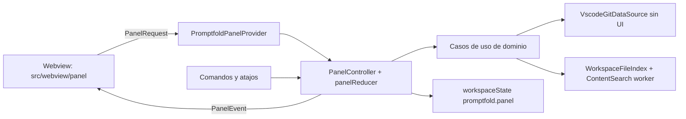

# Panel de Promptfold

Vista webview de unos 300 px para decidir qué entra al prompt y copiarlo sin QuickPicks. 1.1 cubre Git en vivo y Output, con paridad de `gcopy`. 1.2 agrega Find files. El mockup está en `docs/plans/promptfold-panel-mockup.html`.

Rama: `feature/promptfold-panel`, creada desde `integration/local` @ `6199ab7` (`chore: title the settings group Promptfold`). `integration/local` no se mueve. Este documento no autoriza edits en `src/`.

`docs/` está en `.gitignore`. Estos dos archivos entran con `git add -f`, sin abrir el resto de `docs/`.

## Intención

El panel es para quien copia contexto a un LLM decenas de veces al día desde la barra lateral de VS Code o Cursor, a unos 300 px de ancho. La tarea es decidir qué entra al prompt y copiarlo. Debe sentirse como una sección nativa del sidebar: densa y técnica, en el estilo de la vista de control de código fuente.

- Profundidad: solo bordes (`--vscode-widget-border`, `--vscode-sideBar-border`), sin sombras.
- Medidas: fuente del usuario (`--vscode-font-size`; 13 px en el mockup), base de espaciado de 4 px, radio de 2 px. Controles interactivos de al menos 24 px de alto.
- Tipografía: la del sistema con `--vscode-font-*`. Rutas en `--vscode-editor-font-family` y números con `tabular-nums`.
- Elemento propio: un medidor de tokens apilado (cambios, archivos y árbol) contra la marca del presupuesto.
- Defaults que se descartan: tarjetas con sombra, varios botones primarios y badges de colores. Los únicos colores de estado son los de `gitDecoration` y el warning. Copy es el único botón primario del panel completo.

## Decisiones

### Git en vivo

La sección Git tiene una casilla nativa "Include in prompt", como las de settings de VS Code. Mientras está activa, los repos marcados, el alcance y la base definen los cambios del prompt, y se recargan solos. `Copy changes` copia solo los cambios, como `gcopy`, y no toca la selección de archivos.

Las actuales "Git changes" y "Extensions" quedan colapsadas en 1.1. "Git changes" sigue sirviendo para excluir archivo por archivo, y ahora la alimenta el estado en vivo. En 1.2 se decide si "Extensions" desaparece.

Los cambios de Git ya no marcan archivos en el árbol. `promptfold.diffMode` decide al construir el prompt si entra el contenido de los archivos cambiados. Las casillas del árbol quedan solo para lo que eliges. Hoy `promptfold.selectChanges` sí marca archivos: `src/presentation/commands/git.commands.ts` llama a `setCheckedFiles` después de publicar los cambios. Ese efecto se elimina.

Visibilidad:

- Con "Include in prompt" activo, el medidor muestra el tramo de cambios y la barra de estado agrega `+ Git: N repos`.
- Cualquier Copy, Preview o Save as (panel, paleta o atajo) incluye cambios solo si la casilla está activa.
- El reporte de Show details agrega una línea: `Git changes: included (3 repos, uncommitted)` o `Git changes: not included`.
- Tests: unit de `summarizeSelection` y `selectionStatus` con la casilla encendida y apagada. Integración: `copyFiles` con la casilla apagada no lleva `<changes`, con la casilla encendida sí, y el reporte trae la línea correcta.

`selectionStatus` vive en `src/domain/services/selection-budget.service.ts` y hoy no conoce la casilla. El texto actual de la barra es `$(files) ${fileCount} files · ${tokenLabel} · ${formatLabel}`. El sufijo `+ Git: N repos` se agrega solo con la casilla activa. `N` es la cantidad de repos marcados, no la de cambios.

### Glob

Opción elegida: `picomatch` con versión exacta, única dependencia nueva, más `@types/picomatch` exacto en devDependencies. Entra en 1.2, con Find files.

Los globs de `fcopy` vienen de zsh, con `**`, llaves, clases y extglob. Un matcher propio tendría que reimplementar y mantener esos bordes (puntos iniciales, `**` en medio, llaves anidadas, escapes). `picomatch` no tiene dependencias, es el motor de micromatch y fast-glob, y se le pasan rutas POSIX ya normalizadas, así que Windows no cambia la semántica.

El dominio no importa la librería: queda detrás de un puerto `GlobMatcher`. El test de manifest (`test/manifest.test.ts`, hoy `assert.deepEqual(Object.keys(dependencies), ['ignore'])`) pasa a exigir exactamente `ignore` y `picomatch`. También se agrega `!node_modules/picomatch/**` en `.vscodeignore`, al lado de `!node_modules/ignore/**`.

Los tests por caso cubren `*`, `**`, `?`, `{a,b}`, sufijos, `.blade.php`, dotfiles, archivos sin extensión, entradas con `\` y separadores de Windows. Los sufijos siguen las reglas de `matchesExtension` (`src/presentation/views/extensions.provider.ts`).

### Atajos dentro de la webview

VS Code reenvía al workbench los keydown de la webview que la página no consume, y ahí se resuelven los keybindings con `focusedView == 'promptfold.panel'`.

- El script del panel nunca hace `preventDefault` ni `stopPropagation` en Mod+Enter, Mod+Shift+Enter ni Mod+C.
- No se registra ningún keybinding de Mod+C para el panel. Hoy `promptfold.copyFiles` está en `cmd+c` / `ctrl+c` con `focusedView == 'promptfoldView'` (`package.json`). Ese binding no se copia al panel: Mod+C dentro de un input copia el texto seleccionado.
- Playwright prueba que Mod+Enter y Mod+Shift+Enter con el foco en un input no se consumen y no disparan `postMessage` duplicado, y que Mod+C conserva la acción por defecto.
- Checklist manual en VS Code stable y en Cursor: con el foco en el input de base o en Pattern, Mod+Enter copia el prompt, Mod+Shift+Enter copia los cambios, y Mod+C sobre texto seleccionado copia solo ese texto.

Atajo global candidato para Copy changes: se verifica contra los keybindings por defecto de VS Code stable y de Cursor. En Cursor, `cmd+k`, `cmd+l` y `cmd+i` están ocupados. En Windows se evita `ctrl+alt` por AltGr. Si no queda una combinación libre, se publica sin atajo global y se documenta cómo asignarlo.

### Medidor

`role="meter"`, `aria-valuemin="0"`, `aria-valuemax` igual al presupuesto y `aria-valuenow` limitado al máximo.

`aria-valuetext` describe el desglose. El mismo texto va en `title`. Bajo la barra hay una leyenda mínima: tres marcas con `changes`, `files` y `tree`, además del texto de desglose.

- Dentro del presupuesto: `41k of 64k tokens: changes 12k, files 27k, tree 2k`
- Con exceso: `84k of 64k tokens, 20k over budget: changes 31k, files 50k, tree 3k`

Con `tokenBudget = 0` no hay meter: queda un texto de estado con el desglose y la acción "Set a token budget".

### Dónde se escriben las casillas de Output

Escriben en el ámbito donde vive el valor efectivo: Workspace si ya hay un valor de workspace, y si no, User. Así no se ensucia `.vscode/settings.json`. `changeOutputFormat` pasa a usar el mismo helper. Hoy escribe siempre `ConfigurationTarget.Workspace` (`src/presentation/status/selection-status.bar.ts`, llamada a `update` de `outputFormat`).

Un valor solo de carpeta (`workspaceFolderValue`) no cuenta como valor de workspace para esta regla: el write va a User. No se agrega un tercer target.

## Arquitectura



El host es la fuente de verdad. La webview no tiene lógica de dominio.

Casos de uso nuevos en `src/domain/use-cases/`:

| Caso | Responsabilidad |
| --- | --- |
| `git/describe-repositories` | Nombre, rama, upstream, ahead/behind y número de cambios, leídos del estado de la API de Git sin lanzar procesos. |
| `git/list-base-branches` | Upstream, dev y main primero, después el resto. Extiende `baseChoices` (`src/domain/services/git-changes.service.ts`). Hoy `baseChoices` solo devuelve upstream, dev y main. |
| `git/collect-changes` | Recibe alcance, base y modo de untracked. En 1.1 el alcance commit es "Last commit": `getCommit('HEAD')` y el mensaje, paridad con `gcopy --last`. No abre QuickPick. El selector de commit queda para 1.2. |
| `files/find-files` | Pattern y Contains. 1.2. |
| `selection/apply-file-selection` | Add o Replace, y registra el historial. 1.2. |
| `prompt/summarize-selection` | Alimenta el medidor y la barra de estado. |

Servicios puros:

- `change-context.service.ts` calcula los repos marcados al inicio. Las marcas no se persisten: se recalculan cada vez que se resuelve el panel.
- En 1.2, `file-pattern.service.ts` reparte los tokens entre globs (`picomatch`, detrás de `GlobMatcher`) y sufijos (`matchesExtension`).

El provider del panel se registra antes del chequeo de workspace en `activate` (`src/extension.ts`). Hoy, si no hay carpeta, `activate` muestra "Please open a workspace folder to use this extension." y retorna. El panel tiene que existir antes de ese return para poder dibujar el estado sin carpeta. Las webviews no tienen `viewsWelcome`, por eso los estados vacíos los dibuja el panel.

Estados vacíos de la sección Git, cada uno con su acción:

| Estado | Texto | Acción |
| --- | --- | --- |
| Git no disponible | `Git is not available in this window.` | "Show Git extension": abre la búsqueda `@builtin git` en Extensions. |
| Sin repos | `No Git repositories in this workspace.` | "Initialize repository" (`git.init`). |
| Sin carpeta | `Open a folder to build prompts from its files.` | "Open folder". |

`VscodeGitDataSource` pierde los QuickPick y el InputBox de `src/infrastructure/datasources/vscode-git.datasource.ts` (el pick de commit alrededor de las líneas 262-269 y el pick de base más el InputBox alrededor de las líneas 312-340). La infraestructura deja de preguntar al usuario. El contrato `GitDataSource.getChangesForScope` ya recibe `options.base` / `options.commit` / `options.forcedBase`; el panel los llena.

Contains corre en un `worker_threads`, parte de Node, sin dependencias nuevas. Respeta el resolver (ignore, sensibles, generados, binarios y `maxFileBytes`), se cancela, y se termina por timeout si una regex se atasca.

La webview se escribe en TypeScript dentro de `src/webview/panel/`. Se compila con un `tsconfig.webview.json` nuevo (`lib` DOM, ESM) hacia `out/webview`. El `tsconfig.json` del host incluye hoy todo `src` y excluye `test`. Tiene que excluir `src/webview/**`, porque ese árbol se compila aparte. `panel-html.ts` se queda en `src/presentation/panel/`: corre en el extension host, arma el HTML con el nonce, el `cspSource` y las URIs, y lo compila el tsconfig de Node.

Sin bundler, sin frameworks y sin Webview UI Toolkit. Los iconos son SVG inline.

## Estilos

`@tailwindcss/cli` con versión exacta en devDependencies. El CLI trae su propio `tailwindcss`; si la instalación muestra que hace falta como peer, también va exacto. `dependencies` no cambia en 1.1.

Script:

```json
"build:webview-css": "tailwindcss -i src/webview/panel/panel.css -o media/panel.css --minify"
```

`compile` pasa a `npm run build:webview-css && tsc -p ./ && tsc -p tsconfig.webview.json`. Así entra también en `vscode:prepublish`, que ya llama a `compile`. Hoy `compile` es solo `tsc -p ./`.

`media/panel.css` es un artefacto de build: se agrega a `.gitignore` y no se commitea. El VSIX sí lo lleva. `.vscodeignore` ya excluye `src/**`, así que el CSS fuente no entra.

El CI falla si el CSS no está generado. Los dos workflows que compilan son `.github/workflows/test.yml` y `.github/workflows/publish.yml`.

- Después de `compile`, un paso falla si `media/panel.css` no existe o está vacío.
- Otro paso corre `npx vsce ls` y exige que `media/panel.css` esté y que `src/webview/panel/panel.css` no.
- La integración también comprueba que el `<link>` del panel apunte a un archivo que existe.

Fuente `src/webview/panel/panel.css`, sin Preflight:

```css
@import 'tailwindcss/theme' layer(theme);
@import 'tailwindcss/utilities' layer(utilities);
@source '../';
@source '../../presentation/panel/panel-html.ts';

@theme {
  --color-*: initial;
  --font-*: initial;
  --radius-*: initial;
  --text-*: initial;
  --spacing: 4px;
  --text-ui: var(--vscode-font-size);
  --text-ui--line-height: 1.5;
  --text-meta: calc(var(--vscode-font-size) * 0.92);
  --text-meta--line-height: 1.4;
  --color-sidebar: var(--vscode-sideBar-background);
  --color-fg: var(--vscode-foreground);
  --color-fg-muted: var(--vscode-descriptionForeground);
  --color-widget-border: var(--vscode-widget-border);
  --color-button: var(--vscode-button-background);
  --color-button-fg: var(--vscode-button-foreground);
  --color-button-hover: var(--vscode-button-hoverBackground);
  --color-button-secondary: var(--vscode-button-secondaryBackground);
  --color-input: var(--vscode-input-background);
  --color-input-border: var(--vscode-input-border);
  --color-focus: var(--vscode-focusBorder);
  --color-git-modified: var(--vscode-gitDecoration-modifiedResourceForeground);
  --color-git-added: var(--vscode-gitDecoration-addedResourceForeground);
  --color-git-deleted: var(--vscode-gitDecoration-deletedResourceForeground);
  --color-git-untracked: var(--vscode-gitDecoration-untrackedResourceForeground);
  --color-git-submodule: var(--vscode-gitDecoration-submoduleResourceForeground);
  --color-warning: var(--vscode-editorWarning-foreground);
  --color-error: var(--vscode-errorForeground);
  --color-list-hover: var(--vscode-list-hoverBackground);
  --color-list-active: var(--vscode-list-activeSelectionBackground);
  --font-ui: var(--vscode-font-family);
  --font-mono: var(--vscode-editor-font-family);
  --radius-control: 2px;
}
```

- `--color-*: initial` borra la paleta por defecto. En el panel solo existen los tokens mapeados a `--vscode-*`, así que una clase como `bg-blue-500` no genera nada.
- `--text-*: initial` deja solo `text-ui`, que sigue el tamaño de fuente del usuario, y `text-meta`, un 92 % para ramas, contadores y rutas secundarias. Cada uno tiene su line-height. Ninguna clase del panel usa `rem`.
- El test de clases literales rechaza valores arbitrarios con `rem`, como `text-[0.8rem]` o `p-[1rem]`.
- El paso de CI que valida `media/panel.css` falla si el CSS generado contiene `rem`.
- Alto contraste usa `--vscode-contrastBorder` y `--vscode-contrastActiveBorder` dentro del mismo `@theme`. En Dark Modern y Light Modern esos tokens son null en el color registry de VS Code 1.125.0.

`panel-html.ts` tiene su propio `@source` porque el host lo compila aparte del árbol DOM. El test de clases literales cubre `src/webview/**/*.ts` y también `src/presentation/panel/panel-html.ts`.

CSP intacta: `style-src ${cspSource}` con un solo `<link>`. Sin CDN, sin `<style>` y sin atributos `style`. Los anchos del medidor se fijan por CSSOM (`element.style.width`), que la CSP permite.

CSP con nonce: `default-src 'none'; style-src ${cspSource}; script-src 'nonce-…'; img-src ${cspSource} data:`. Sin recursos remotos.

Clases solo literales en `src/webview/**/*.ts` y en `panel-html.ts`:

- Sin concatenar, sin template literals y sin construir nombres de clase.
- Los estados se expresan con variantes de atributo (`aria-checked:`, `aria-pressed:`, `aria-disabled:`, `data-[over=true]:`) o con `classList.toggle('clase-literal', condición)`.
- Un test unitario recorre esos archivos. Falla si encuentra `${`, `+` o `.join(` dentro de un `class` / `className`, o un valor arbitrario con `rem`.
- La regla queda documentada en `CONTRIBUTING.md`, en la sección Architecture.

`prettier --check src` también formatea `panel.css`. Si Prettier no acepta alguna directiva de Tailwind, el archivo va a `.prettierignore` y se documenta.

Playwright carga el mismo `media/panel.css` generado. El cierre del commit de Tailwind reporta el tamaño de `media/panel.css` y la nueva lista de `vsce ls`.

## Protocolo

`src/shared/panel-protocol.ts`, compartido por los dos tsconfig. Uniones discriminadas por enum.

```ts
export enum PanelRequestType {
  Ready = 'ready',
  SetGitIncluded = 'git.setIncluded',
  SetScope = 'git.setScope',
  SetBase = 'git.setBase',
  ToggleRepository = 'git.toggleRepository',
  SetUntracked = 'git.setUntracked',
  CopyChanges = 'git.copyChanges',
  RefreshGit = 'git.refresh',
  RunEmptyAction = 'empty.run',
  SetFormat = 'output.setFormat',
  SetIncludeTree = 'output.setIncludeTree',
  SetCompactWhitespace = 'output.setCompactWhitespace',
  Copy = 'output.copy',
  Preview = 'output.preview',
  SaveAs = 'output.saveAs',
  OpenSetting = 'openSetting',
  SetSectionOpen = 'section.setOpen'
}
```

Eventos del host a la webview en 1.1: `state` (snapshot completo más `strings` localizados), `git.repositories`, `git.branches` y `output.measure`.

En 1.2 se agregan `find.query` y `find.apply` como requests, y `find.progress` y `find.result` como eventos. Llevan `requestId` y los resultados viejos se descartan.

Los textos de la webview no se hardcodean en el script. El host los manda en `state.strings`, producidos con `vscode.l10n.t`, para que entren al bundle es y los vea `test/l10n-bundle.test.ts`.

## Persistencia

- `workspaceState`, clave `promptfold.panel`: secciones abiertas, casilla de Git, alcance, base y los campos de Find. `SetSectionOpen` escribe si Git, Find files y Output están abiertas. Cerradas, el encabezado muestra el resumen: `Git · 2 repos · Current`, `Find · 38 files`, `Output · XML · 84k`.
- Las marcas de repos se recalculan desde el contexto cada vez que se resuelve el panel. No se guardan.
- `getState` / `setState` de la webview: texto a medio escribir, filtro de ramas, scroll y foco. Así no hace falta `retainContextWhenHidden`.
- `promptfold.untrackedContent` es un setting, no estado de panel.

Los snapshots viejos de historial traen `promptChanges` (`SelectionSnapshot` en `src/extension.ts`). Al restaurar el historial se ignoran. No se migran y no vuelven a marcar archivos.

## QuickPicks

Se eliminan de la ruta interactiva:

- La cadena de `selectChanges`: repos, alcance, Add/Replace y el modal "Include the submodule diff?". El comando queda y, si no recibe argumentos, usa el estado del panel. Los argumentos programáticos se conservan: `target`, `presetScope`, `presetBase` (`git.commands.ts`).
- `promptfold.gitChanges.setScope` y `promptfold.gitChanges.setBase`, con sus menús inline (`view == promptfold.gitChanges && viewItem == gitRepo`) y sus claves nls.
- Los pickers de commit y de base dentro de `VscodeGitDataSource`.

Quedan como fallback:

- `selectByExtension` en el menú contextual de carpetas, porque está acotado a esa carpeta.
- `changeOutputFormat` al hacer clic en la barra de estado: es un solo paso. El write pasa al helper de ámbito.
- El diálogo nativo de Save as.
- El modal de presupuesto, solo cuando la copia viene de la paleta o de un atajo. Desde el panel el exceso ya se ve en línea.

En el panel, Scope, Untracked y Format son controles segmentados de una fila (`role="radiogroup"`, flechas). Etiquetas: `Current`, `Staged`, `Last commit`, `Branch`; `Names`, `Content`; `XML`, `MD`, `Text`. El estado lo da el segmento, no una fila resaltada. `Last commit` en 1.1 no reutiliza "A specific commit" de `gitScopeMenu`: ese picker desaparece de la ruta interactiva. Untracked sigue siendo `names` y `content`.

## package.json

Vista, la primera del contenedor `promptfold`, antes de `promptfoldView`:

```json
{ "type": "webview", "id": "promptfold.panel", "name": "%promptfold.panel.name%" }
```

`activationEvents` gana `onView:promptfold.panel`. Las vistas actuales "Git changes" y "Extensions" conservan `visibility: collapsed`.

Comando nuevo `promptfold.copyChanges`, category Promptfold, título "Copy changes". Se quitan `promptfold.gitChanges.setScope` y `promptfold.gitChanges.setBase`.

Atajos con la vista enfocada (`focusedView == 'promptfold.panel'`):

- `ctrl+enter` / `cmd+enter` copia el prompt.
- `ctrl+shift+enter` / `cmd+shift+enter` copia los cambios.

No hay binding de Mod+C para el panel.

Settings nuevos:

| Setting | Tipo | Default |
| --- | --- | --- |
| `promptfold.untrackedContent` | `names` \| `content` | `names` |
| `promptfold.repositoryMarkLimit` | number, mínimo 1 | 8 |

Scripts y devDependencies de 1.1: `build:webview-css`, el `compile` nuevo, `@tailwindcss/cli` exacto y `@playwright/test` exacto. En 1.2: `picomatch` exacto en dependencies y `@types/picomatch` exacto en devDependencies.

nls en `package.nls.json` y `package.nls.es.json` para la vista, el comando y los settings. Inglés de la vista: "Prompt". Español: "Prompt", igual que el contenedor no se traduce. El comando: "Copy changes" / "Copiar cambios".

## Formato de salida

El valor de `scope` se conserva: `uncommitted`, `staged`, `commit`, `branch`.

El encabezado nuevo reemplaza los atributos actuales `base` y `head` de `serializeChanges` (`src/domain/services/prompt-xml.service.ts`) en los alcances que no son branch. En `branch`, `base` se queda: es la base de la comparación y no es lo mismo que la rama actual.

XML, alcance uncommitted:

```xml
<changes repo="api" scope="uncommitted" branch="feature/panel" upstream="origin/feature/panel" ahead="2" behind="0">
```

XML, alcance branch:

```xml
<changes repo="api" scope="branch" base="dev" branch="feature/panel" upstream="origin/feature/panel" ahead="2" behind="0">
```

En el alcance commit, el mensaje va en `<message>` con CDATA. En detached HEAD se escribe `detached="abc1234"` en lugar de `branch`. Sin upstream no se escriben `upstream`, `ahead` ni `behind`. En modo names, cada untracked va como `<change path="…" status="untracked"/>`. Un archivo sensible no entra nunca, ni en names ni en content.

Markdown. El heading actual es `## Git changes — api (uncommitted, main → HEAD)` (`prompt-formats.service.ts`). Pasa a:

```markdown
## Git changes — api (uncommitted)
Branch: feature/panel · Upstream: origin/feature/panel · 2 ahead, 0 behind
```

Plain. Encima de los `=== DIFF ===` actuales:

```text
=== REPO api · feature/panel → origin/feature/panel · 2 ahead, 0 behind ===
```

Detached usa el commit corto en lugar del nombre de rama. Sin upstream, la flecha y el ahead/behind no se escriben.

## Riesgos

- Submódulos que pasan de `git.detectSubmodulesLimit` aparecen sin estado, como filas desactivadas.
- Repo sin upstream: no hay ahead/behind y la opción Upstream no aplica.
- Detached HEAD: se muestra el commit corto. Repo sin commits: se desactivan "A specific commit" y "Compare branch".
- Si un repo no tiene la base elegida, su fila lo dice y se omite de `collect-changes`.
- Windows: rutas POSIX, raíces sin distinguir mayúsculas, CRLF y la ruta del worker vía `__dirname`.
- Cursor: hay que verificar que su versión base cumpla `engines.vscode` `^1.125.0`. También su choque de atajos.
- Rendimiento en un workspace grande: el índice se recorre una vez y se invalida con FileSystemWatcher con debounce. El pattern se resuelve en memoria. Contains va en el worker con progreso y tope en `maxFiles`. La lista de ramas se pide solo cuando se abre Branch. El marcado inicial se detiene en `promptfold.repositoryMarkLimit` (8).
- Los snapshots viejos con `promptChanges` se ignoran al restaurar el historial.
- Multi-root sigue con `workspaceFolders[0]`.
- Light Modern define `editorWarning.foreground` en `#BF8803`. Sobre `#F8F8F8` el contraste es 2.93:1. El texto de exceso no puede ir en ese color sobre el sidebar: va en un chip con texto `#1F1F1F` sobre el warning, que da 5.29:1. Dark Modern (`#CCA700` sobre `#181818`) sí pasa como texto (7.69:1). El mockup usa el chip en los dos temas para no depender del tema.
- `gitDecoration.deletedResourceForeground` en oscuro (`#c74e39` sobre `#181818`) da 3.87:1. Sirve para una marca gráfica, no como único texto de 13 px. La letra de estado va en `--vscode-foreground` y la marca usa el color de Git.
- En Light Modern, `descriptionForeground` es `#3B3B3B`, igual que `foreground`. La jerarquía de meta no puede ser de color: es tamaño (`text-meta`) y peso.

## Tests

Unit con `node:test` (`npm run test:unit`):

- 1.1
  - Contexto inicial: editor en un repo, en un submódulo, sin editor, más de N repos, y nunca repos fuera del workspace.
  - Orden de las bases: upstream, dev, main, después el resto.
  - Overview con detached HEAD, sin upstream y sin commits.
  - Encabezados XML, Markdown y Plain contra las salidas de la sección Formato.
  - Untracked names y content, incluido un archivo sensible que nunca entra.
  - Mensaje del commit en `<message>` con CDATA.
  - `panelReducer`.
  - `summarizeSelection` y `selectionStatus` con la casilla encendida y apagada. Encendido: el texto incluye `+ Git: 3 repos` y el desglose trae changes. Apagado: no hay sufijo Git y changes es 0.
  - `aria-valuetext` del medidor, dentro y fuera de presupuesto, y el caso `tokenBudget = 0` sin `role="meter"`.
- 1.2: globs y sufijos con picomatch (casos de la sección Glob) y el matcher del worker.

Integración con Mocha (`npm run test:vscode`):

- El fixture gana un remoto bare para ahead/behind y un submódulo.
- 1.1
  - `copyChanges`.
  - `selectChanges` con un stub que falla si se abre un QuickPick. Los argumentos programáticos no abren UI.
  - Copy con la casilla apagada no lleva `<changes`. Encendida sí. El reporte trae `Git changes: included (3 repos, uncommitted)` o `Git changes: not included`.
  - La vista resuelve bien sin carpeta: el estado vacío "Open a folder to build prompts from its files." y la acción "Open folder".
- 1.2: Find Add y Replace.
- El panel se maneja por la API que devuelve `activate()`. Hoy `activate` no devuelve esa API: el commit que registra el provider la expone.

Playwright: `@playwright/test` como devDependency con versión exacta. Corre sobre el HTML que renderiza `panel-html.ts`, con `acquireVsCodeApi` simulado por `addInitScript`. Job nuevo en `.github/workflows/test.yml`, ubuntu.

- 1.1, secciones Git y Output: flujo solo con teclado; radiogroups con flechas; anuncios `aria-live`; repo limpio desactivado; estados vacíos con su acción; presupuesto superado y `aria-valuetext` del meter; atajos en inputs; temas claro, oscuro y alto contraste a 300 px.
- 1.2: la sección Find files.

Checklist manual antes de publicar 1.1, en VS Code stable y en Cursor:

- Atajos con el foco en un input: Mod+Enter, Mod+Shift+Enter y Mod+C.
- La vista aparece encima de Files.
- Los tres temas.
- El atajo global no choca con nada.
- La versión base de Cursor cumple `engines`.

## Orden de commits

1.1, Git y Output con paridad con `gcopy`. Cada commit deja tests verdes de lo que ya existe. No se mezclan Tailwind y el panel en el mismo commit.

1. `refactor: keep Git pickers out of the data source`
2. `feat: describe repositories with upstream and ahead/behind`
3. `feat: add per-repository headers to the changes output`
4. `refactor: share the selection summary and show live Git`
5. `build: generate the panel CSS with Tailwind` — CLI exacto, script, `compile`, `.gitignore`, pasos de CI, test de clases literales y regla en `CONTRIBUTING.md`.
6. `feat: add the Promptfold panel with the Git section`
7. `feat: add the Output section and token meter`
8. `feat: drive commands and shortcuts from the panel`
9. `test: cover the Git and Output sections with Playwright`
10. `docs: document the panel for 1.1`

La entrada de CHANGELOG de 1.1 va en el commit 10.

```markdown
## [1.1.0] - Unreleased

### Added

- Promptfold panel in the sidebar, with live Git changes and the output controls.

### Changed

- Git changes no longer tick files in the file tree. `promptfold.diffMode` decides whether the content of changed files goes into the prompt.
- Untracked files are listed by name only by default. Set `promptfold.untrackedContent` to `content` to include their content.
- The scope and base pickers for Git changes are gone. Choose the scope and the base branch in the Promptfold panel.
```

`Added` describe el panel. No se publica 1.1.0 en este plan: la sección queda `Unreleased` hasta el release.

1.2, Find files:

1. `build: add picomatch as the glob matcher` — actualiza el test de manifest y `.vscodeignore`.
2. `feat: find files by pattern and content` — índice, resolver y worker con cancelación y timeout.
3. `feat: add the Find files section` — requests y eventos `find.*`, y `apply-file-selection` con historial.
4. `test: cover Find files with Playwright`
5. `docs: document Find files`

También para 1.2, sin commit asignado: selector de commit en el panel, base por repo, Find acotado a una carpeta (reemplazaría el fallback de `selectByExtension`), retirar Extensions, opciones de mayúsculas y palabra completa, auditoría con axe, multi-root, presets de `extensionPresets` como chips, y el atajo global si en 1.1 no hubo uno libre.

- Plantillas de instrucción en Output: "Review", "Explain", "Refactor (return full files)" y "Custom" (= `promptfold.systemMessage`). Control segmentado, textos por l10n, y cada plantilla editable en settings (`promptfold.instructionTemplates`). Origen: issue #13 de Thomas-McKanna/Files2Prompt.
- Importación única desde Files2Prompt: si existen `files2prompt.systemMessage` o `files2prompt.ignoredExtensions` en la configuración del usuario y los equivalentes de promptfold están vacíos, ofrecer una notificación "Import settings from Files2Prompt" una sola vez (flag en `globalState`). Tests de que no pisa valores existentes.
- README, nueva FAQ: ".DS_Store and other OS files" (ya excluidos; `.promptignore` funciona sin git; issue #17) y "Does Promptfold apply the model's reply? No, by design" (copiar es el flujo; sin red ni API keys).

## Mockup

`docs/plans/promptfold-panel-mockup.html` es estático y autocontenido: CSS y JS inline, sin recursos remotos y sin Tailwind. Declara los mismos tokens del `@theme` apuntando a `--vscode-*`, con `--vscode-font-size: 13px`, sin `rem`. Las reglas del panel solo usan esos tokens. Los hex viven en las variables `--vscode-*`.

Colores descargados de VS Code 1.125.0, la versión de `engines`:

- `extensions/theme-defaults/themes/dark_modern.json` y `light_modern.json`. Sidebar `#181818` / `#F8F8F8`. Botón `#0078D4` / `#005FB8`.
- `gitDecoration.*` desde `extensions/git/package.json` de ese tag.
- `editorWarning.foreground` desde `src/vs/platform/theme/common/colors/editorColors.ts`: `#CCA700` / `#BF8803`.
- Hover y selección de lista: registry `#2A2D2E` y `#04395E` en oscuro; Light Modern pisa hover con `#F2F2F2` y selección con `#E8E8E8`.

El mockup muestra el diseño completo, Find files incluido, sin rótulos de versión ni de mockup dentro de los marcos. El reparto 1.1 / 1.2 vive solo en este documento.

Marcos de 300 px con el chrome del sidebar: cabecera Promptfold, vista Prompt, Files colapsada debajo. El marco de trabajo, con Git, Find files y Output abiertas, cabe en 640 px de alto.

- Marco de trabajo: tres repos (api con ↑2 ↓0 y `12 files` a la derecha, web con submódulo, docs `clean` en fuente UI y desactivado), Scope `Current | Staged | Last commit | Branch`, Untracked `Names | Content`, Pattern `.schema.ts,.spec.ts`, Contains `zod` con el toggle "Regex", Output `XML | MD | Text`, medidor sobre 64k con leyenda `changes` / `files` / `tree`. La barra de estado muestra `+ Git: 2 repos`.
- Marco cerrado: las tres secciones colapsadas, con `Git · 2 repos · Current`, `Find · 38 files` y `Output · XML · 84k`.
- Marco de rama: `Branch`, filtro, y upstream / dev / main / la coincidencia larga en el mismo `radiogroup`. Aviso de más de 8 repos, detached y `No upstream` en fuente UI.
- Marco pendiente: skeleton con `aria-busy` y sin la palabra "Loading". El relleno es `--color-widget-border` (1.36:1 en Dark Modern, 1.19:1 en Light Modern, bajo 1.5:1). El borde es `--color-placeholder` (6.16:1 y 4.28:1) para que la barra se vea. Find sin coincidencias. Un glob inválido en Pattern (`This pattern is not a valid glob.`) y el error de regex en Contains, con "Regex" pulsado.
- Marco vacío: tres paneles cortos (Git no disponible, sin repos, sin carpeta), cada uno con su texto y su acción.
- Marco de snippets y log: filas `archivo:líneas` con tokens, una invalidada con `File changed`, filtro `All | Error | Warning`, aviso `3 identifiers can be redacted.` y `Last error`. No muestra identificadores.

El medidor del marco de trabajo usa `role="meter"`, el `aria-valuetext` de exceso y el mismo `title`. `aria-valuenow` queda en 64000, el máximo. "Include in prompt", "Include tree" y "Compact whitespace" son casillas nativas.

## Snippets y logs

Copiar un `laravel.log` entero no cabe en el presupuesto. Copiarlo a mano pierde la ruta y las líneas. El caso es una entrada con un código CFDI y un XML dentro: el prompt debe llevar el error, los frames de `app/` y el XML, sin blobs ni el archivo completo.

1.1 no depende del panel y puede mergearse antes. 1.2 vive en el panel. El camino masivo no cambia: un archivo sensible sigue sin entrar al prompt salvo esta acción explícita, y solo después de confirmar.

### 1. Copy selection as prompt

Comando `promptfold.copySelectionAsPrompt`, category Promptfold, título "Copy selection as prompt" / "Copiar selección como prompt".

Menú `editor/context`, `when: editorHasSelection`, group `navigation`. Atajo `ctrl+shift+c` / `cmd+shift+c` con `when: editorTextFocus && editorHasSelection`. `editorTextFocus` evita pisar `promptfold.copyOpenFiles`, que ya usa `cmd+shift+c` cuando `focusedView == 'promptfoldView'`. Antes de publicar, verificar el atajo contra los keybindings por defecto de VS Code stable y de Cursor. Si choca, se publica sin atajo y se documenta cómo asignarlo.

Cada selección, multicursor incluido, sale en el formato activo. El orden es el del documento (línea de inicio, luego carácter), no el orden en que se crearon los cursores. Una sola línea usa el mismo rango cerrado: `10-10`. La ruta es relativa a la carpeta del workspace, con separadores POSIX. Un archivo fuera del workspace usa solo el nombre, sin la ruta absoluta. Un untitled usa `Untitled-1`. El texto es el del editor, incluidos los cambios sin guardar.

XML, Markdown y Plain, en ese orden de ejemplo:

```xml
<file name="storage/logs/laravel.log" lines="10-42"><![CDATA[...]]></file>
```

```markdown
### storage/logs/laravel.log (lines 10–42)
```

```text
=== storage/logs/laravel.log:10-42 ===
```

El guion de Markdown es el en dash del requisito (`10–42`). Plain usa guion (`10-42`). `serializedFile` hoy no escribe `lines`; el atributo se agrega solo cuando hay rango. Un archivo completo no cambia su encabezado.

Archivos ignorados: `.gitignore`, `.promptignore` y `promptfold.exclude` no bloquean este comando. No se reutiliza el aviso que hoy devuelve false en `exclusion.prompt.ts`. Binarios no aplican: la selección del editor ya es texto.

Sensible: los patrones de `sensitive-patterns.constant.ts` (`.env`, `*.pem`, `*.key`, `id_rsa*`, `.npmrc` y el resto). Si el archivo coincide y no está en `promptfold.allowSensitive`, un modal pregunta y Cancel es el default. Cancel no copia nada, ni las otras selecciones. El mensaje no incluye el contenido:

`{0} looks like a secret ({1}). Copy it into the prompt anyway?`

Botones: `Copy` y `Cancel`. Si está en `allowSensitive`, no pregunta otra vez. En los dos casos el reporte cuenta el nivel. Línea nueva de Show details, mismo estilo que `api/.env — sensitive (.env)`:

`Included after confirmation: .env — sensitive (.env)`

Si no hubo sensible: no se escribe esa línea. El presupuesto usa el mismo aviso que `copyFiles` (`This selection is about {0} tokens, {1} over the budget of {2}. Change promptfold.tokenBudget, copy anyway, or cancel.`). `maxFiles` y `maxTotalBytes` también aplican.

Archivos: `src/domain/services/selection-range.service.ts` (puro), `prompt-xml.service.ts`, `prompt-formats.service.ts`, `src/presentation/commands/selection.commands.ts`, un confirm nuevo en `src/presentation/pickers/sensitive-confirm.prompt.ts`. No se extiende el bloqueo de `exclusion.prompt.ts`.

Tests: unit de los tres encabezados con los strings de arriba; multicursor en el mismo archivo produce dos `<file>`; untitled y fuera de workspace; ignorado entra; sensible cancelado no escribe el clipboard y no deja un reporte de éxito; sensible confirmado escribe la línea del reporte; `allowSensitive` no pregunta; sobre presupuesto ofrece Copy anyway.

### 2. Compactación de logs

Setting `promptfold.compactLogs`, boolean, default `true`. Aplica a `*.log` que entren al prompt y a selecciones de ellos, venga del comando nuevo, del árbol o de un snippet. Otro tipo de archivo no se compacta.

Servicio puro `src/domain/services/log-compact.service.ts`. Reglas, en este orden:

- Una corrida de más de 200 caracteres. Si solo es `[0-9a-fA-F]`, `[hex 2.1 KB]`. Si es alfabeto base64, `[base64 2.1 KB]`. El tamaño es el largo de la corrida, con el mismo formateo que `formatByteSize`. El ejemplo del requisito es `[base64 2.1 KB]`.
- Frames consecutivos cuyo path tiene un segmento `vendor` o `node_modules`. En Windows el segmento no distingue mayúsculas. Una corrida se vuelve `… N vendor frames`. Un frame de `app/` o `src/` entre dos corridas no se traga: quedan dos marcadores. Un frame de la app nunca se compacta.
- Dentro de la misma entrada, un bloque de 300 caracteres o más que ya apareció se vuelve `[repeated above]`. La primera copia se queda. No cruza de una entrada a la siguiente.

El XML no se parsea. Las etiquetas cortas se quedan porque no son una corrida de 200. Un sello en base64 dentro del XML sí se sustituye.

Fixture `test/fixtures/laravel.log`, sintético y anonimizado. No se pega un log real. Debe conservar un código `CFDI40999`, un frame bajo `app/`, y una etiqueta XML. Debe reducir una corrida base64, una corrida hex, una corrida de frames `vendor/` y un mensaje repetido en el JSON de contexto. El test afirma el texto resultante, no solo que pesa menos.

Riesgos: un log de cientos de MB no se lee entero en este paso; la compactación opera sobre el texto que ya se va a copiar. CRLF se trata como fin de línea antes de buscar frames. Encoding inválido no tira el comando: el texto ya vino del editor. En Windows, `vendor` y `node_modules` se comparan sin caso.

### 3. Snippets

1.2. Comando `promptfold.addSelection`, título "Add selection to prompt" / "Agregar selección al prompt", mismo `editor/context` y `editorHasSelection`. Sin atajo por defecto.

Cada selección agregada es una fila del panel: casilla, `archivo:líneas`, tokens. Copy, Preview y Save as incluyen las marcadas, además de los archivos y de Git si su casilla está activa. Cerrada, la sección dice `Snippets · N`.

Persisten en `workspaceState` bajo `promptfold.snippets`, no dentro de `promptfold.panel`, para que un reset del panel no las borre. Al agregar se guarda el hash del texto. Al copiar, si el editor está dirty o el hash del rango ya no coincide, la fila se desmarca, muestra `File changed` y no entra. No se relee en silencio. El aviso no incluye el diff.

Requests nuevos: `snippet.add`, `snippet.toggle`. El host sigue siendo la fuente de verdad.

Archivos: `src/domain/services/snippet-store.service.ts`, `src/shared/panel-protocol.ts`, `src/webview/panel/`, `src/presentation/panel/`.

Tests: add y toggle; una fila invalidada no sale en el prompt; el hash igual sí sale; dos selecciones del mismo archivo son dos filas.

### 4. Entradas de log

1.2. Sección Log del panel. Si el editor activo no es un `*.log`, el texto es `Open a log file to list its entries.` y no se lee otro archivo. Si lo es, se listan como mucho las últimas 50 entradas: hora, nivel y primera línea, con casilla. Filtro segmentado `All | Error | Warning`. `Last error` marca la última entrada ERROR, CRITICAL, ALERT o EMERGENCY y desmarca las otras filas del log. No copia sola. No toca los snippets.

El encabezado es el de Laravel/Monolog:

```text
[2026-04-02 10:23:45] production.ERROR: CFDI40999 stamp rejected
```

Parser puro `src/domain/services/log-entries.service.ts`. Lectura `src/infrastructure/filesystem/log-tail.reader.ts`: `stat`, luego los últimos 1 MiB (`LOG_TAIL_BYTES = 1048576`). Si hay menos de 50 encabezados y el archivo es mayor, se lee el MiB anterior, hasta 8 MiB (`LOG_TAIL_MAX_BYTES = 8388608`). La primera entrada cortada se descarta. Nunca se lee el archivo entero. UTF-8 inválido se reemplaza y no lanza. Los saltos son `\r?\n`. Solo se lee el documento que el editor ya tiene abierto, o una ruta contenida en el workspace. Un argumento programático fuera de eso no se lee.

Riesgos: un log que rota entre el tail y el copy se trata como archivo cambiado, igual que un snippet. CRLF no parte un encabezado. En Windows la ruta del descriptor usa el URI del editor, no un string armado a mano.

Tests: fixture con 60 entradas donde solo las últimas 50 se listan; un archivo de más de 8 MiB no se lee completo (el reader recibe un doble que cuenta los bytes); `Last error` marca solo esa fila; un encabezado partido al inicio del tail no aparece; filtro Error esconde INFO.

### 5. Redacción

Settings:

| Setting | Tipo | Default |
| --- | --- | --- |
| `promptfold.redact` | `off` \| `ask` \| `on` | `ask` |
| `promptfold.redactSource` | boolean | `false` |

`ask` y `on` aplican solo a `*.log` y a selecciones de ellos. `off` no redacta. `promptfold.redactSource` es el interruptor de "para todo": mientras es false, un `.php`, `.ts`, `.js`, `.vue` o cualquier archivo que no sea log no se toca, aunque `redact` sea `on`.

En `ask`, el modal no muestra los valores encontrados:

`Redact {0} RFC, {1} CURP, {2} emails and {3} phones before copying?`

Botones: `Redact` (default) y `Copy as-is`. Cerrar el modal no copia. `on` redacta logs sin preguntar.

Sustituciones: `[RFC]`, `[CURP]`, `[email]`, `[phone]`. Servicio puro `src/domain/services/redact.service.ts`. Corre después de la compactación, para no redactar dentro de un blob ya sustituido.

Casos que el test debe fijar. Válidos: `XAXX010101000`, `XEXX010101000`, un RFC moral de 12 con mes `01` y día `01`, un CURP con la forma de 18 (4 letras, fecha, `H` o `M`), `ana@example.com`, `+52 55 1234 5678`. Falsos positivos que no deben coincidir: un RFC en minúsculas, un código con mes `34`, `ABCDEFGHIJKLMNOPQR`, `array@2`, `5512345678` pelado, y `2026-04-02 10:23:45`. El teléfono exige `+` o separadores. El RFC exige mes 01–12 y día 01–31, en mayúsculas.

El aviso y el reporte cuentan por tipo. Nunca escriben el identificador. Un XML de CFDI conserva sus etiquetas; un RFC dentro del XML se sustituye solo si la redacción está activa.

### package.json, nls y riesgos comunes

Comandos nuevos en `package.json`, junto a los actuales, con category Promptfold:

- `promptfold.copySelectionAsPrompt`
- `promptfold.addSelection` (1.2)

Menús: `editor/context` para los dos. Atajo solo para el primero, con la cláusula de arriba.

Settings nuevos, con descripción en `package.nls.json` y `package.nls.es.json`:

- `promptfold.compactLogs`
- `promptfold.redact`
- `promptfold.redactSource`

Inglés de las descripciones, para no parafrasearlas en el build:

`Replace long blobs, vendor stack frames, and repeated blocks when a .log file or a selection from one is copied.`

`Redact RFC, CURP, emails and phone numbers in .log files. ask is the default. off never redacts. on redacts logs without asking.`

`Also apply promptfold.redact to files that are not logs. Off by default.`

Español, neutro:

`Sustituye blobs largos, frames de vendor y bloques repetidos al copiar un archivo .log o una selección de uno.`

`Redacta RFC, CURP, correos y teléfonos en archivos .log. ask es el default. off no redacta. on redacta logs sin preguntar.`

`Aplica promptfold.redact también a archivos que no son logs. Apagado por default.`

Los textos de diálogo van por `vscode.l10n.t` y entran a `test/l10n-bundle.test.ts`. El español del bundle es neutro. La skill de i18n de LobeHub no aplica: este repo usa `package.nls` y `l10n/bundle.l10n.es.json`.

Riesgos que cruzan los cinco puntos: no leer un log de cientos de MB entero; no poner una ruta absoluta en el prompt; no mostrar un secreto en un modal; CRLF; UTF-8 inválido; mayúsculas de Windows en `vendor` y `node_modules`; un archivo que rota entre listar y copiar. El camino masivo de sensibles no se afloja.

### Orden de commits

1.1, independiente del panel:

1. `feat: format editor selections with path and line range`
2. `feat: copy the editor selection as a prompt`
3. `feat: compact logs before they enter the prompt`

1.2, con el panel:

4. `feat: add selections to the prompt as snippets`
5. `feat: list recent log entries from the file tail`
6. `feat: redact identifiers in logs before copying`
7. `docs: document snippets, logs, and the FAQ`

El commit 7 agrega las dos FAQ al README: ".DS_Store and other OS files" (ya excluidos; `.promptignore` funciona sin git; issue #17) y "Does Promptfold apply the model's reply? No, by design" (copiar es el flujo; sin red ni API keys). No se escriben en este plan.

### Mockup

Marco `snippets` en `docs/plans/promptfold-panel-mockup.html`, aparte del marco de trabajo para no pasar los 640 px. Snippets con una fila marcada `storage/logs/laravel.log:120-186` y una invalidada `File changed`. Log con filtro `All | Error | Warning`, dos filas ERROR, el aviso `3 identifiers can be redacted.` y el botón `Last error`. Sin valores redactados, sin fila resaltada, casillas nativas.

## Fuera de alcance de este documento

No describe un release, un push ni un tag. No mueve `integration/local`. El build de `src/` es otro turno.
